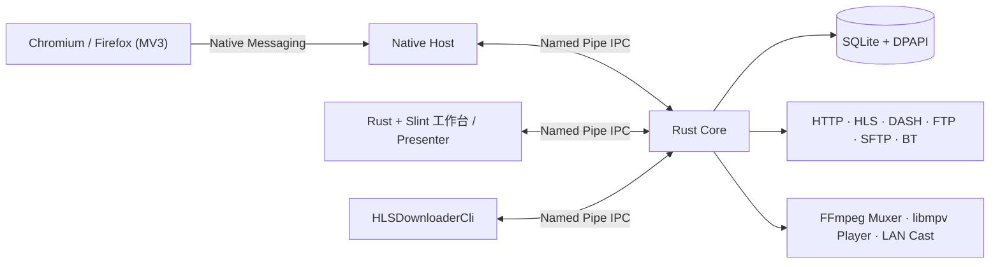

<div align="center">
  

  <h1>HLS Downloader</h1>

  <p><strong>不只是 m3u8 下载器，而是一套面向 Windows 的现代下载工作台。</strong></p>
  <p>多线程文件加速 · HLS · DASH · 双轨音视频合流 · FTP/SFTP · BitTorrent · 浏览器接管 · 本地播放 · 局域网投屏</p>

  <p>
    <strong>简体中文</strong> · <a href="README_EN.md">English</a>
  </p>

  <p>
    <a href="https://github.com/ciaooo55/hls-downloader/releases/latest"></a>
    <a href="https://github.com/ciaooo55/hls-downloader/actions/workflows/ci.yml"></a>
    <a href="LICENSE"></a>
    
    
  </p>
</div>

---

HLS Downloader 是一款面向 Windows 的原生桌面下载管理器，将普通 HTTP/HTTPS 多线程加速下载、HLS/DASH 流媒体与双轨音视频合流、FTP/FTPS、SFTP、BitTorrent，以及浏览器下载接管统一纳入一个可恢复、可追踪的持久化任务队列。

与传统“关闭窗口即中断下载”的工具不同，HLS Downloader 的所有活动传输与任务状态都由独立的后台 **Rust Core** 持有，原生桌面工作台、浏览器扩展与轻量进度/确认弹窗均通过本地 IPC 与其协作。即使关闭主界面、播放器或浏览器，正在执行的下载任务依然稳健运行。

## 🚀 下载

Windows x64 用户请前往 [GitHub Releases](https://github.com/ciaooo55/hls-downloader/releases/latest) 下载 **Windows-x64.exe** 安装程序；如需部署或免安装运行，也可选择同版本的 **MSI** 或 **Portable ZIP**。需要浏览器下载接管与网页媒体嗅探时，请同时下载配套的 **Chromium**（Chrome / Edge）或 **Firefox** 扩展包。

当前源码目标版本为 [10.1.0（发布草案）](docs/releases/v10.1.0.md)，最新已发布正式版为 [10.0.0](docs/releases/v10.0.0.md)。Windows 安装包暂未代码签名，更新版本时请手动运行安装包完成覆盖升级；Firefox 扩展提供待签名包与构建源码，在标准版 Firefox 中永久安装需经 Mozilla 签名。

安装向导支持自定义安装目录。首次使用时默认保存至当前 Windows 用户的系统“下载”文件夹（支持已迁移到其他磁盘的系统下载目录），也可在全局设置或每次下载确认时自由更改。

### 安装与数据

- **10.x 原地升级**：10.x 系列沿用统一配置与 `%LOCALAPPDATA%\HLS Downloader\v7` 数据目录，覆盖安装自动保留已有任务、站点规则与本地加密凭据（Portable 便携版数据独立保存在程序目录下的 `data/`）。
- **早期版本（5.x）**：旧版 Tauri/Python 架构的数据格式与当前原生 Core 不兼容，请先备份已下载文件后全新安装。

### 系统要求

| 项目 | 要求 |
| --- | --- |
| 操作系统 | Windows 10 或 Windows 11（64 位） |
| 处理器架构 | **仅 x64**（内置 `ffmpeg`、`libmpv` 与 `curl-impersonate` 原生组件均为 x64 构建） |
| 运行环境 | 纯原生 Rust + Slint 构建，无需安装 Java / JRE 或额外运行库 |
| 安装权限 | EXE / MSI 安装与升级需管理员权限；Portable 便携版解压即用 |
| 浏览器扩展 | Chrome、Edge 等 Chromium 系浏览器或 Firefox（Manifest V3） |
| 显示与缩放 | 最低分辨率 1024×600，支持系统高 DPI 缩放与浅色 / 深色 / 跟随系统主题 |

## ✨ 为什么用它

| | |
| --- | --- |
| ⚡ **多线程加速与断点续传**<br>支持 HTTP Range 动态尾块拆分、断点恢复、全局与单任务限速，以及签名链接过期后的刷新续传（保留已下载进度）。 | 🎬 **流媒体与双轨无损合流**<br>支持点播/直播 HLS（`.m3u8`）、DASH（`.mpd`）及音视频分离双轨流（如 Bilibili `.m4s`），支持精确画质选择与 FFmpeg 无损 `.mp4` 封装。 |
| 🌐 **顺滑的浏览器接管**<br>提供网页视频悬停一键画质胶囊、弹窗搜索筛选与批量下载，支持标准确认弹窗与一键静默快速下载。 | 🧠 **独立 Rust Core 守护**<br>Core 独立持有 SQLite 状态与 DPAPI 加密凭据，并通过 Win32 Job Object 托管子进程，界面退出或异常不留孤儿进程。 |
| 📦 **全协议统一队列**<br>HTTP/HTTPS、HLS/DASH、FTP/FTPS、SFTP（含 HTTP/SOCKS 代理隧道）与 BitTorrent/Magnet 共享同一套命名队列与计划调度。 | 🧩 **高效桌面工作台**<br>配备可折叠底部任务检视抽屉（实时速度曲线与分片状态图）、通配符批量建任务、抓站同步、远程 ZIP 预览与 CLI 工具。 |
| 📺 **边播边下与局域网投屏**<br>内置 `libmpv` 浮层与画中画播放器，支持兼容流媒体与 Range 文件边下边播，并可推送至局域网 DLNA / Chromecast / TVBox 设备。 | 🛟 **稳健安装与升级回滚**<br>安装与升级流程自动协调运行中进程、注册 Native Messaging Host，并在异常时支持安全回滚以保护已有数据。 |

## 🔌 支持范围

| 类型 | 支持 | 说明 |
| --- | :---: | --- |
| HTTP / HTTPS | ✅ | 多线程分段加速、动态尾块切分、断点续传、过期签名 URL 刷新续传 |
| HLS（`.m3u8`） | ✅ | 点播 / 直播、AES-128 解密、精确画质选择、无损 `.mp4` 封装 |
| DASH（`.mpd` / 双轨 `.m4s`） | ✅ | 多轨道流媒体与分离音视频并发下载、FFmpeg 自动无损混流 `.mp4` |
| FTP / FTPS | ✅ | 多连接传输、断点续传、HTTP CONNECT / SOCKS 代理隧道 |
| SFTP | ✅ | 原生 SSH 文件传输、主机密钥校验与代理隧道 |
| BitTorrent / Magnet | ✅ | 种子探测、多文件勾选与磁力链接下载 |
| 浏览器扩展 | ✅ | Chromium（Chrome / Edge）与 Firefox Manifest V3 + Native Messaging |
| 高级资源工具与 CLI | ✅ | 命令行控制、静态站点抓取同步、远程 ZIP 目录预览（见 [工具指南](docs/free-edition.md)） |
| 本地播放与边播边下 | ✅ | 内置 `libmpv` 播放与画中画，支持已就绪分片/区间边下边播 |
| 局域网投屏 | ✅ | 局域网媒体代理发布、DLNA / Chromecast 设备选择与 TVBox 推送 |
| 在线字幕翻译 | 可选 | 网页视频实时语音识别与字幕翻译（需自备 API Key，见 [QwenCloud 配置指南](docs/guides/qwencloud-subtitles.md)） |

## 🧭 三步开始

1. 从 [Releases](https://github.com/ciaooo55/hls-downloader/releases/latest) 安装桌面端；如需接管浏览器下载或嗅探网页视频，同时安装同版本的 Chromium 或 Firefox 扩展。
2. 点击网页下载链接、点击视频右上角悬停画质胶囊，或在桌面端直接粘贴链接 / cURL、拖放种子与任务文件创建下载。
3. 在工作台或双模式进度窗中查看实时速度与分片状态，随时暂停、续传、播放或投屏——后台 Core 会独立守护传输直至完成。

## 🌐 浏览器接管是怎么工作的

1. **直连多线程与流媒体加速**：普通 HTTP/HTTPS 文件下载、HLS（`.m3u8`）、DASH（`.mpd`）以及音视频分离双轨流（如 Bilibili DASH `.m4s`）通过 Native Messaging 连同请求上下文直接交给桌面 **Rust Core**，由桌面引擎执行多线程分段加速、断点续传（含签名轮换后的链接刷新续传）以及 FFmpeg 无损 `.mp4` 混流封装。
2. **一次性负载安全保全**：对于一次性 `POST` 表单下载及网页端动态生成的 `Blob` / `data:` 文件，扩展会在浏览器完成响应接收后再安全移交桌面端导入，避免因重复发起 `POST` 请求导致表单失效或扣费风险。
3. **无打扰的灵活控制**：同时支持传统下载确认弹窗与一键**静默快速下载**模式。按住 `Alt` 点击链接、在扩展弹窗中一键关闭自动接管，或命中站点/文件排除规则时，下载将原样保留在浏览器中执行，互不干扰。

一旦任务交由桌面端接手，浏览器便不再绑定下载生命周期——即使关闭标签页或整个浏览器，Rust Core 仍会独立完成后续传输与封装。

## 🏗️ 架构



**Rust Core 是下载状态、SQLite 数据库与加密凭据的唯一持有者**。Slint 桌面工作台、轻量确认/进度弹窗、Native Messaging Host 与命令行工具均通过命名管道（Overlapped Named Pipe IPC）与同一个 Core 通信；外部媒体与传输辅助进程通过独立会话与 Win32 Job Object 隔离管理。

## 📁 项目结构

| 目录 | 作用 |
| --- | --- |
| `native_shell/` | Rust Core 守护引擎、SQLite 持久化、多协议传输器与后台媒体服务 |
| `crates/` | 版本化 IPC 协议契约（`hls-protocol`）与共享客户端库（`hls-client`） |
| `native_clients/` | Native Messaging Host、命令行工具（CLI）、更新器与原生启动器 |
| `native_ui/` | Rust + Slint 桌面工作台、任务检视抽屉、确认/进度/完成窗口与内置播放器界面 |
| `extension/` | 基于 WXT 构建的 Chromium / Firefox Manifest V3 浏览器扩展 |
| `scripts/` | Windows 构建、打包、安装升级与自动化验证脚本（见 [脚本说明](scripts/README.md)） |
| `docs/` | 使用指南、系统架构与版本发布说明（见 [文档索引](docs/README.md)） |
| `config/` | 受版本管理的功能范围与签名信任配置（见 [配置说明](config/README.md)） |

## 🛠️ 从源码构建

本项目面向 Windows x64 构建，开发环境需准备 Rust MSVC 工具链、Visual Studio C++ Build Tools、Node.js 与 `pnpm`（无需 JDK）。请在仓库根目录运行以下命令：

运行集成验证：

```powershell
.\scripts\build-v7.ps1 -Task test
```

或按模块独立测试与构建：

```powershell
# Rust Core 与共享工作区组件
cargo test --manifest-path native_shell/Cargo.toml --lib

# Native Slint 工作台与 Presenter
cargo test --manifest-path native_ui/Cargo.toml

# Chromium / Firefox 浏览器扩展
cd extension
pnpm install --frozen-lockfile
pnpm test
pnpm run build
```

更多文档与开发参考：

- [完整文档索引](docs/README.md) · [命令行、抓站同步与远程 ZIP 预览](docs/free-edition.md)
- [运行架构](docs/architecture/v7-architecture.md) · [模块职责映射](docs/architecture/v7-module-map.md) · [源码布局说明](docs/architecture/source-layout-and-history.md)
- [安装、升级与数据目录](docs/guides/v7-local-upgrade.md) · [下载缓存与边播边下](docs/guides/download-cache-and-playback.md)
- [维护脚本入口](scripts/README.md) · [验证状态说明](docs/validation/v7-verification.md)

## 🔐 安全、隐私与合法使用

请仅下载你有权访问、保存或处理的内容，并遵守所在司法辖区的法律法规、网站服务条款与内容许可协议。

项目合规与说明文档：[LICENSE](LICENSE) · [SECURITY](SECURITY.md) · [PRIVACY](PRIVACY.md) · [TERMS](TERMS.md) · [Third-party notices](THIRD_PARTY_NOTICES.md)

## ⭐ 喜欢这个项目？

如果 HLS Downloader 对你有帮助，欢迎点亮一颗 **Star**。遇到 Bug、站点兼容性问题或有功能建议，欢迎前往 [Issues](https://github.com/ciaooo55/hls-downloader/issues) 反馈交流。

<div align="center">
  <sub>Built with Rust &amp; Slint for fast, resilient downloads and seamless browser handoff on Windows.</sub>
</div>
