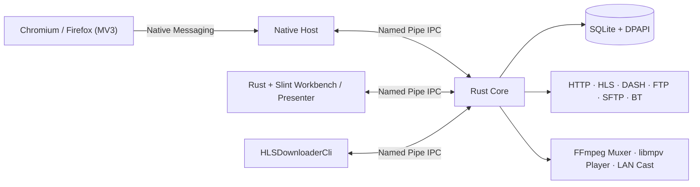

<div align="center">
  

  <h1>HLS Downloader</h1>

  <p><strong>More than an m3u8 downloader — a modern native download workbench for Windows.</strong></p>
  <p>Multi-connection HTTP · HLS · DASH · Dual-track muxing · FTP/SFTP · BitTorrent · Browser handoff · Local playback · LAN casting</p>

  <p>
    <a href="README.md">简体中文</a> · <strong>English</strong>
  </p>

  <p>
    <a href="https://github.com/ciaooo55/hls-downloader/releases/latest"></a>
    <a href="https://github.com/ciaooo55/hls-downloader/actions/workflows/ci.yml"></a>
    <a href="LICENSE"></a>
    
    
  </p>
</div>

---

HLS Downloader is a native Windows desktop download manager that brings multi-connection HTTP/HTTPS file acceleration, HLS/DASH and dual-track streaming media, FTP/FTPS, SFTP, BitTorrent, and browser download handoff into one recoverable, persistent task queue.

Unlike downloaders whose transfers live inside the UI window, HLS Downloader runs active jobs inside an independent background **Rust Core**. The native Rust + Slint workbench, browser extension, and lightweight confirmation/progress windows connect to that Core as clients — so closing the main window, video player, or browser never interrupts active downloads.

## 🚀 Download

For Windows x64, visit [GitHub Releases](https://github.com/ciaooo55/hls-downloader/releases/latest) and download **Windows-x64.exe** (or choose **MSI** for managed deployment, or **Portable ZIP** for no-install use). For browser download takeover and media sniffing, install the matching **Chromium** (Chrome / Edge) or **Firefox** extension from the same release.

The current source targets [10.1.0 (release draft)](docs/releases/v10.1.0.md); the latest published stable release is [10.0.0](docs/releases/v10.0.0.md). Windows installers are currently unsigned, so updates are installed manually by running the new installer; the Firefox extension is provided unsigned alongside its build source, as permanent installation in standard Firefox requires Mozilla signing.

The setup wizard supports choosing a custom installation directory. By default, downloads are saved to your Windows `Downloads` Known Folder (including folders relocated to another drive) and can be changed in Settings or per download.

### Installation and data

- **10.x in-place upgrades:** 10.x releases share the same `%LOCALAPPDATA%\HLS Downloader\v7` profile directory and upgrade cleanly in place while preserving tasks, site rules, and encrypted credentials (Portable builds keep isolated data inside `data/` next to the executable).
- **Earlier 5.x versions:** Legacy Tauri/Python databases are incompatible with the native Core; back up existing downloads and perform a clean installation.

### Requirements

| Item | Requirement |
| --- | --- |
| Operating system | Windows 10 or Windows 11 (64-bit) |
| CPU architecture | **x64 only** (bundled native `ffmpeg`, `libmpv`, and `curl-impersonate` binaries target x64) |
| Runtime | Pure native Rust + Slint — no Java / JRE or external runtime required |
| Privileges | Administrator rights for EXE / MSI install or upgrade; none required for Portable ZIP |
| Browser | Chrome, Edge (Chromium), or Firefox (Manifest V3) for browser integration |
| Display | 1024×600 minimum; automatic system DPI scaling with Light, Dark, and System themes |

## ✨ Why HLS Downloader

| | |
| --- | --- |
| ⚡ **Multi-connection speed & resume**<br>Dynamic HTTP Range tail splitting, breakpoint recovery, global and per-task speed limits, and expired presigned URL refresh without losing downloaded bytes. | 🎬 **HLS, DASH & dual-track muxing**<br>VOD/live HLS (`.m3u8`), DASH (`.mpd`), and split video+audio streams (such as Bilibili `.m4s`) with exact quality selection and lossless FFmpeg `.mp4` muxing. |
| 🌐 **Seamless browser handoff**<br>On-video hover quality pills, popup search/category filtering, batch capture, confirmation dialog, and 1-click silent quick download. | 🧠 **Independent Rust Core**<br>Owns SQLite state and DPAPI-encrypted credentials independently of UI windows, with Win32 Job Object child-process cleanup. |
| 📦 **One queue, every protocol**<br>HTTP/HTTPS, HLS/DASH, FTP/FTPS, SFTP (with HTTP/SOCKS proxy tunneling), and BitTorrent/Magnet share named queues and scheduling. | 🧩 **Productive desktop workbench**<br>Collapsible right-side Task Inspector Drawer (live speed curve & segment map), wildcard batch URLs, site crawl/sync, remote ZIP preview, and CLI. |
| 📺 **Play-while-downloading & LAN cast**<br>Built-in `libmpv` overlay and Picture-in-Picture player with play-while-downloading support, plus DLNA / Chromecast / TVBox LAN streaming. | 🛟 **Safe upgrades & rollback**<br>Installer flows coordinate running processes, register the Native Messaging Host, and roll back cleanly on failure to protect user data. |

## 🔌 Supported workflows

| Type | Support | Notes |
| --- | :---: | --- |
| HTTP / HTTPS | ✅ | Multi-connection segmented acceleration, dynamic tail split, resume, presigned URL refresh |
| HLS (`.m3u8`) | ✅ | VOD / Live, AES-128 decryption, exact variant selection, lossless `.mp4` muxing |
| DASH (`.mpd` / dual-track `.m4s`) | ✅ | Multi-representation streams & split video+audio concurrent download with FFmpeg `.mp4` muxing |
| FTP / FTPS | ✅ | Multi-connection transfers, resume, HTTP CONNECT / SOCKS proxy tunneling |
| SFTP | ✅ | Native SSH file transfer, host-key verification, and proxy tunneling |
| BitTorrent / Magnet | ✅ | Torrent probing, multi-file selection, and magnet-link workflows |
| Browser extensions | ✅ | Chromium (Chrome / Edge) and Firefox Manifest V3 + Native Messaging |
| CLI, Site Crawl & ZIP Preview | ✅ | Headless CLI, static site crawl/sync, and HTTP Range remote ZIP preview ([Tools guide](docs/free-edition.md)) |
| Local playback | ✅ | Bundled `libmpv` overlay & PiP player, including play-while-downloading |
| LAN casting | ✅ | LAN media proxy publishing, DLNA / Chromecast device selection, and TVBox push |
| Subtitle translation | Optional | Real-time web video speech-to-subtitle translation with user API key ([QwenCloud guide](docs/guides/qwencloud-subtitles.md)) |

## 🧭 Get started in three steps

1. Install the desktop app from [Releases](https://github.com/ciaooo55/hls-downloader/releases/latest), and load the matching Chromium or Firefox extension if you want browser takeover and media detection.
2. Click a download link, pick a stream quality pill from the on-page video overlay, or paste URLs / cURL commands and drop `.torrent` or task files directly into the workbench.
3. Inspect live speed and segment maps, pause/resume, play locally, or cast over LAN from the workbench — the background Core keeps transfers running even if you close the UI.

## 🌐 How browser handoff works

1. **Direct Multi-Connection & Stream Acceleration:** Ordinary HTTP/HTTPS file downloads, HLS (`.m3u8`), DASH (`.mpd`), and dual-track video+audio streams (such as Bilibili DASH `.m4s`) are handed directly to the desktop **Rust Core** via Native Messaging for multi-connection segmented acceleration, breakpoint resume (including rotated presigned URL refresh), and lossless FFmpeg `.mp4` muxing.
2. **Safe One-Time Payload Preservation:** One-time `POST` form downloads and browser-generated `Blob` / `data:` files are safely handed off after the browser receives the payload, avoiding duplicate `POST` submissions or broken single-use tokens.
3. **Non-Intrusive User Control:** Supports both an interactive confirmation dialog and 1-click **silent quick download** (`静默快速下载`). Holding `Alt` while clicking, turning off auto-takeover in the popup, or matching an excluded site/file rule leaves downloads in the browser untouched.

Once a task is handed off, the browser is no longer the owner of the transfer lifecycle — closing the tab or exiting the browser leaves Core-managed downloads running uninterrupted.

## 🏗️ Architecture



**The Rust Core is the sole owner of download state, SQLite persistence, and DPAPI-encrypted credentials.** The Slint workbench, confirmation/progress HUD windows, Native Messaging Host, and CLI communicate with the Core over overlapped Named Pipe IPC, while external media and helper child processes are isolated with Win32 Job Objects.

## 📁 Repository layout

| Path | Responsibility |
| --- | --- |
| `native_shell/` | Rust Core daemon, SQLite store, multi-protocol transfer engines, and media services |
| `crates/` | Versioned IPC protocol (`hls-protocol`) and shared client library (`hls-client`) |
| `native_clients/` | Native Messaging Host, CLI, updater, and native desktop launcher |
| `native_ui/` | Rust + Slint workbench, inspector drawer, confirmation/progress/completion HUDs, and player UI |
| `extension/` | WXT-based Chromium and Firefox Manifest V3 browser extensions |
| `scripts/` | Windows build, packaging, installer, upgrade, and validation scripts ([Script index](scripts/README.md)) |
| `docs/` | Guides, architecture notes, and release documentation ([Documentation index](docs/README.md)) |
| `config/` | Versioned feature parity and update-signer contracts ([Config overview](config/README.md)) |

## 🛠️ Build from source

Development targets Windows x64 and requires the Rust MSVC toolchain, Visual Studio C++ Build Tools, Node.js, and `pnpm` (no JDK needed). Run the following commands from the repository root:

Run the integrated test suite:

```powershell
.\scripts\build-v7.ps1 -Task test
```

Or test and build individual components:

```powershell
# Rust Core
cargo test --manifest-path native_shell/Cargo.toml --lib

# Native Slint Workbench & Presenter
cargo test --manifest-path native_ui/Cargo.toml

# Browser Extension (Chromium & Firefox)
cd extension
pnpm install --frozen-lockfile
pnpm test
pnpm run build
```

Further documentation:

- [Documentation index](docs/README.md) · [CLI, site crawl/sync & remote ZIP preview](docs/free-edition.md)
- [Runtime architecture](docs/architecture/v7-architecture.md) · [Module map](docs/architecture/v7-module-map.md) · [Source layout & history](docs/architecture/source-layout-and-history.md)
- [Installation, upgrades & user directories](docs/guides/v7-local-upgrade.md) · [Cache lifecycle & play-while-downloading](docs/guides/download-cache-and-playback.md)
- [Maintenance scripts](scripts/README.md) · [Verification overview](docs/validation/v7-verification.md)

## 🔐 Security, privacy, and lawful use

Only download content that you are authorized to access, store, or process, and comply with applicable laws, website terms of service, and content licenses in your jurisdiction.

Project documents: [LICENSE](LICENSE) · [SECURITY](SECURITY.md) · [PRIVACY](PRIVACY.md) · [TERMS](TERMS.md) · [Third-party notices](THIRD_PARTY_NOTICES.md)

## ⭐ Like the project?

If HLS Downloader is useful to you, consider giving the repository a **Star**. Bug reports, site compatibility feedback, and feature requests are welcome in [Issues](https://github.com/ciaooo55/hls-downloader/issues).

<div align="center">
  <sub>Built with Rust &amp; Slint for fast, resilient downloads and seamless browser handoff on Windows.</sub>
</div>
