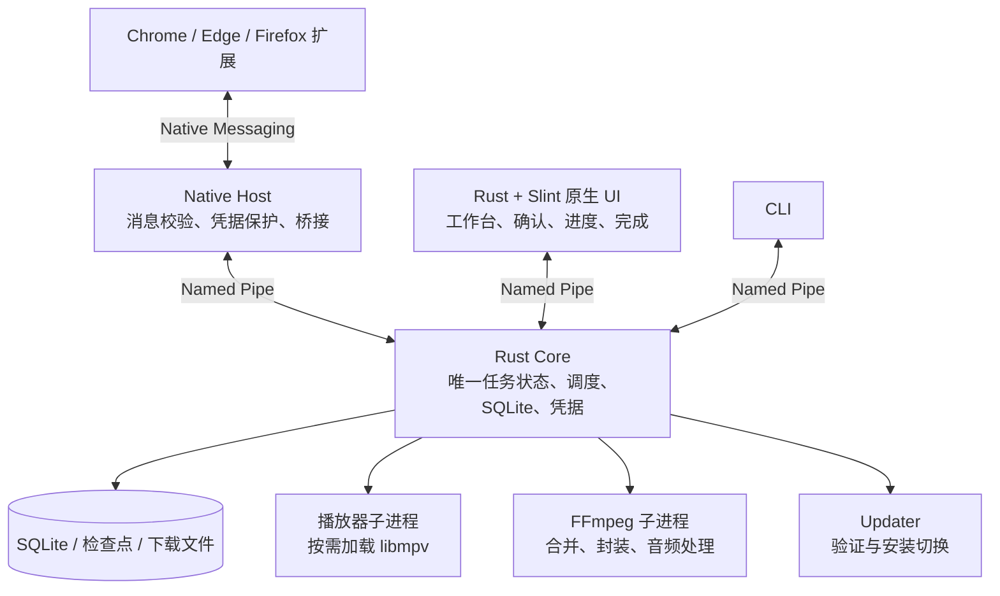

# HLS 项目优化与分阶段原生化实施计划

## 一、目标、依据和完成标准

### 1. 最终方向

在保留现有功能、中文界面和主要操作习惯的前提下，将项目收敛为：

**轻量浏览器扩展 → Native Messaging 桥接 → 单一 Rust Core → 按需启动的 Rust 原生界面和媒体处理进程。**

已经确定的产品选择：

- 分阶段迁移到 Rust＋Slint，功能验收完成后移除 Compose、Java 运行时及相关发布依赖。
- 保留完整离线安装包，播放器、FFmpeg 和现有本地能力随包提供。
- 保留现有工作台外观、主题、布局和操作，不改造成 IDM 的界面。
- IDM 作为接管、识别、进程协作和资源使用方面的参考；项目继续维护自己的协议、数据和扩展功能。

### 2. IDM 参考的使用规则

| 参考部分 | 证据情况 | 采用方式 |
|---|---|---|
| 插件请求观察、MIME、附件识别、请求信息收集 | 已检查原版插件代码 | 借鉴事件顺序和识别条件，适配现有 MV3 扩展 |
| 请求交给桌面，收到裁决再取消浏览器传输 | 插件和部分原生调用链有对应证据 | 保留，并强化为项目自己的持久接收与恢复合同 |
| 主程序异步接收后返回成功 | 已检查部分静态控制流 | 接收成功与用户点击开始分开处理 |
| 媒体来源关联、页面观察和窗口几何上报 | 插件代码可见 | 借鉴关联和生命周期管理，保留当前 DOM 悬浮入口 |
| 动态分段算法、完整原生悬浮窗、全部调度细节 | 尚未完整还原，部分重建代码与反编译结果冲突 | 使用项目自身可验证的实现，不据此声称等同 IDM |
| 重建 C/C# 实现 | 属于恢复或重建产物 | 只有与原始证据及项目回归相符的部分才能采用 |

依据见现有 [IDM 核查记录](A:/Ubuntu/测试/hls-downloader/docs/validation/idm-native-handoff.md)。参考目录保持只读，不把 IDM 私有协议、DLL 或重建程序引入产品运行依赖。

### 3. 当前基线

以下用于确定优化重点，不能当作新架构已经取得的成果：

| 项目 | 已知基线 |
|---|---:|
| Chrome / Firefox 扩展 | 各约 0.76 MiB，含资源 |
| 当前 Core Release | 约 14.75 MiB |
| Native Host | 约 3.70 MiB |
| Presenter | 约 27.47 MiB |
| Presenter 内嵌中文字体 | 约 15.68 MiB |
| 最近完整 Portable 候选包 | 196.36 MiB，2026-11-03 产物 |
| 候选包内 FFmpeg / libmpv | 解压后约 157.50 / 114.21 MiB |
| 功能验收表 | 33 项，23 项已有 verified 记录、10 项 partial |

完整包体积依据见 [组件体积报告](A:/Ubuntu/测试/hls-downloader/artifacts/v7-productization/candidate/PACKAGE-SIZE-REPORT.json)。该包早于当前部分源码修改，实施前必须重建同一源码状态的比较基线。

### 4. 不可退化的合同

- 浏览器原响应、已经保存的文件和任务断点不能丢失。
- 同一次交接不能创建重复任务或发起并行重复下载。
- Cookie、Authorization、Referer、Origin、User-Agent、请求方法、可重放正文和签名查询参数按实际请求保留。
- 桌面持久接收并确认能够呈现后，下载责任转给桌面；用户随后取消，结束本次下载。
- 未查清交接结果时，使用原业务 ID 查询，不能另建交接。
- 已经发出的普通文件请求优先保全原响应，完成后导入；不能把“一次性响应”转换成盲目重新 GET。
- UI、浏览器和播放器退出不应破坏 Core 正在执行的下载。
- 现有 HTTP、HLS、DASH、FTP、SFTP、BT、字幕、播放器、投屏、TVBox、抓站、ZIP、CLI 等能力保留。
- 下载正确性和数据兼容通过后，才接受体积或速度优化。

---

## 二、目标架构与接口设计

### 1. 运行架构

### 2. 进程职责和生命周期

| 进程 | 职责 | 生命周期 |
|---|---|---|
| Core | 任务、队列、下载、持久数据、凭据、托盘、后台服务 | 单实例，可独立于 UI 和浏览器运行 |
| Native Host | 浏览器协议解析、消息限额、凭据保护、Core 转发 | 跟随浏览器 Native Messaging 会话 |
| 原生 UI | 工作台、确认窗、进度窗、完成窗及设置 | 按需启动，同一用户会话内单实例 |
| 播放器 | libmpv 会话及视频输出 | 播放时启动 |
| FFmpeg | 当前需要的媒体处理 | 每项处理结束即退出，限制并发 |
| CLI / Updater | 命令入口、受控更新 | 短生命周期 |

具体约束：

- Core 继续独占生产 SQLite，其他进程不能另开一套任务数据库。
- 工作台与 Presenter 合并为一个 UI 可执行文件、一个 UI 进程，共用字体、主题和 IPC 客户端。
- `--workbench` 创建工作台；`--presenter` 只创建需要的确认、进度或完成窗口。
- 确认下载时不提前构建千任务列表、播放器或全部设置页面。
- 工作台关闭后，按现有关闭设置处理窗口；无须保留的 UI 窗口全部释放。仅保留托盘后台时，由 Core 承担。
- UI 单实例入口使用同用户本地激活管道转发显示请求，并处理首实例尚未就绪的启动竞争。
- Core 和 UI 保留脱离浏览器 Job 的启动行为，避免 Firefox 关闭宿主时连带终止。
- 下载期间不加载 libmpv；未启用字幕或投屏时，不启动相应网络会话、采集或发现循环。
- 播放器崩溃只影响播放会话，下载和投屏状态分别维护。

### 3. 源码边界

建立根 Cargo workspace，采用以下五个职责明确的成员：

| 模块 | 内容 |
|---|---|
| `crates/protocol` | 共享消息类型、协议常量、帧编解码；仅依赖序列化等轻量库 |
| `crates/client` | Named Pipe 客户端、连接恢复、启动定位、配置路径及必要的 Windows 凭据保护辅助 |
| `native_shell` | Core、数据库、任务调度、下载引擎和后台媒体业务 |
| `native_clients` | Native Host、CLI、Updater 三个入口及各自实现 |
| `native_ui` | 从现有 Presenter 演进的完整 Rust＋Slint UI |

实施要求：

- UI、Host、CLI 和 Updater 不依赖 Core 实现库，不引入 SQLite、下载引擎、BT 或字幕运行时。
- 从现有模块移动实现并更新调用方，避免同时保留两份协议或两套客户端。
- 浏览器 TypeScript 只维护实际跨 Native Messaging 使用的合同，不复制 Core 内部类型。
- 合并 Cargo 锁文件，保留已验证依赖版本；本轮不附带框架升级。
- Slint 以锁文件实际版本 **1.17.1** 为基础，不能把 manifest 中的 `1.16` 范围误认为实际构建版本。
- Compose 在迁移期作为行为和视觉对照；最终替换后删除其源码、构建链及已无消费者的适配分支。

### 4. IPC 和共享类型

继续保留现有 v7 协议、Named Pipe 默认名称、4 字节小端长度及版本化 JSON：

- Core 帧上限保持 4 MiB。
- Native Messaging 入站及出站分别遵循现有 4 MiB / 1 MiB 限制。
- 保留 `Hello`、`Capabilities`、命令、快照和 `WaitEvents`。
- UI 使用独立的命令连接和事件等待连接，避免长轮询阻塞按钮操作。
- 协议中的数值传输 ID、浏览器业务 ID、浏览器 requestId、taskId、handoffId 分别使用，不能互相替代。

本轮需要的接口增量：

| 接口 | 用途及兼容要求 |
|---|---|
| 任务列表分页 | 返回有界任务列表、稳定游标和事件序号，防止历史任务增长后超过帧上限；旧 `Snapshot` 供迁移期调用方使用 |
| 事件重新同步标记 | 事件环已覆盖客户端所需历史时，明确要求重新加载快照，不能静默漏事件 |
| 结构化播放器嵌入请求 | 传递 HWND、矩形和会话代数，替代新 UI 对标题查窗及拼接动作字符串的依赖 |
| UI 激活消息 | 仅包含打开工作台、呈现窗口等临时意图，不承载任务状态或明文凭据 |

分页默认每批 128 项，同时限制编码后大小；单项无法放入时返回明确错误，不截断 JSON。分页期间按任务版本合并事件，拒绝旧版本覆盖新状态；事件历史不足时重新同步。

新增能力通过 `Capabilities` 协商。迁移期旧调用方必须继续工作；Compose 删除后，清除只为它保留且已无消费者的分支。

### 5. 并发和状态所有权

- 保留现有协调器，不把所有引擎一次性改造成新的异步框架。
- Core 锁只覆盖状态校验、短事务和发布；网络、磁盘大块读写、FFmpeg、设备发现、缩略图处理不得占用该锁。
- 工作线程提交带任务代数的结果，暂停、取消或换源后的旧结果不能回写新任务。
- 进度采集沿用现有约 200–250 ms 节奏，合并同周期更新；控制动作、交接和终态立即处理。
- 状态事务提交成功后再发布对应事件。
- 慢客户端使用有界缓冲并触发重新同步，不能阻塞全部客户端。
- 并发下载、连接数、媒体处理数量和重试均受现有配置及队列预算约束，不通过无限增线程提速。

---

## 三、各模块的具体改造

### 1. 浏览器扩展：入口、体积和资源生命周期

按业务边界整理现有大入口：

- 后台负责注册事件和分派，接管、请求上下文、识别、资源列表、字幕、媒体推送各自维护实现。
- `webRequest`、下载事件、点击意图和恢复入口在启动时及时注册。
- 字幕配置、复杂弹窗和非必要设置逻辑按需加载。
- 不能延迟最早期请求观察和页面媒体关联，否则会漏掉首个请求。
- 减少后台、popup、content、主世界脚本间的重复依赖与消息字段。
- 记录各入口原始体积、压缩体积及首次加载脚本，不能只看最终 ZIP。
- 保留 Cookie 分区需要的公共后缀判断，不为缩包删除 `tldts` 的正确性能力。
- 关闭 popup、移除播放器、页面导航和扩展重载时，释放对应观察器、事件监听、定时器及元素引用。

普通资源缓存使用有界容量和过期清理；未决交接单独持久保存，不得被普通资源 LRU 淘汰。容量不足时停止接收新交接并保全浏览器路径，不能删除旧未决记录腾位置。

### 2. 浏览器接管：按入口确定责任转移

| 入口 | 处理方式 |
|---|---|
| 请求发出前、可明确识别的下载链接 | 收集当前请求上下文，交给 Core；收到有效接收结果后阻止浏览器传输 |
| Firefox 符合现有条件的附件 GET | 使用阻塞头部事件进行请求前裁决，保留当前 Cookie 一致性检查 |
| 已经发出的普通文件或音视频文件请求 | 浏览器保全原响应，完成后导入桌面 |
| POST、一次性地址、上下文不完整请求 | 保留浏览器原传输，不自动转换成 GET |
| 下载项已经创建 | 验证文件完成和导入结果，之后再按合同清理 |
| Blob 下载 | 区分真实文件 Blob 与 MediaSource，采用现有可保全方式 |
| 明确绕过、排除站点或策略拒绝 | 本次放行，避免响应阶段再次接管 |

普通 Chrome/Edge MV3 继续使用其允许的能力，不承诺所有入口都能在 DownloadItem 创建前取消。[Chromium 官方限制](https://developer.chrome.com/docs/extensions/reference/api/webRequest)

交接状态需要覆盖：

1. 创建稳定业务 ID，并在发送前保存必要恢复记录。
2. Host 将凭据保护并保存到 Core，再提交交接。
3. Core 原子完成去重、交接记录和相关状态提交。
4. UI 呈现结果与接收结果按既有合同关联。
5. 扩展确认接收和可呈现状态后转移责任。
6. 用户开始、排队、拒绝或取消，由 Core 记录最终结果。
7. 回执丢失、宿主断开或后台休眠，恢复后查询原业务 ID。
8. 已持久接收后的取消不恢复浏览器副本。
9. 已有响应而结果未查清时，保全原响应和源文件。
10. 导入失败、磁盘满、桌面离线时，不误删浏览器文件。

### 3. 请求凭据：保持真实身份和作用域

统一核对扩展、Host、Core 和各引擎的字段使用：

- 保留原始 URL 查询、方法和已确认可重放正文。
- Authorization、自定义身份头、Referer、Origin、User-Agent 来自对应实际请求。
- Cookie 继续按站点授权、Cookie store、分区、域、路径、Secure 和过期时间选取。
- 请求前接管使用同一份 Cookie 快照完成校验和交接。
- 按请求、frame、页面代数、重定向阶段区分身份，不按 URL 直接共享。
- 每次跨来源重定向、子清单、分段、密钥和初始化段请求重新计算可用凭据。
- 不能把上一来源的 Authorization 或 Cookie 带到无作用域授权的新来源。
- 页面请求身份优先于手工默认头；手工配置仅按现有规则补足。
- DPAPI 保护格式、引用关系和现有凭据继续可读。
- UI、导出、日志和错误报告不返回明文凭据。
- Portable 在另一 Windows 身份下无法解密时明确要求重新提供凭据，不静默降级。

### 4. 媒体识别：建立可追溯的证据链

识别按以下顺序组合证据：

1. 播放器实际使用的清单、响应正文及字节来源。
2. 请求链、状态码、Content-Type、Content-Disposition 等网络元数据。
3. 页面 `video/audio/source` 与清单引用关系。
4. 已有站点接口解析。
5. URL 后缀和页面链接等弱线索。

具体设计：

- 200、206、304 按各自语义处理；304 只能关联已知缓存身份，不能当成新正文。
- HLS 主清单、子清单、音轨、字幕、密钥和初始化段保留引用关系。
- DASH 保留命名空间、BaseURL、Period、音视频表示、初始化段与分段模板关系。
- MSE/Blob/Worker 通过实际观察建立播放器归属，不能按“最后出现的视频地址”绑定。
- 同地址的不同鉴权请求、不同 iframe 和不同页面代数分别处理。
- hash 导航保留同一页面媒体；重载、路径或查询变化按当前页面身份规则清理。
- 把识别依据、资源所有者和失败原因保留为可诊断信息。
- DRM、无法读取的上下文及无法证明可重放的资源显示实际限制，不生成看似可用的下载项。

减少重复探测：

- 优先使用网页已取得的清单正文。
- 只有在文档身份、请求身份和响应版本一致时才复用解析结果。
- 页面正文足够时取消对应后台探测。
- 缺少尚未观察的子清单时，保留有界补充探测。
- 失败释放缓存占位，签名或身份变化后允许重试。
- 普通正文解析沿用现有大小上限，不缓存完整媒体。

### 5. 网页悬浮入口

保留现有 DOM 浮层及下载、播放、字幕、投屏、TVBox 菜单。

优化内容：

- 以当前播放器为归属单位，避免多个 iframe 或视频串用资源。
- 统一处理滚动、缩放、播放器尺寸、全屏、画中画、可见性及节点移除。
- 使用现有 ResizeObserver、IntersectionObserver 和集中调度。
- 同一帧最多执行一次必要几何更新。
- 拖动只在交互期间更新；结束立即释放临时监听。
- 播放器移除、暂停识别或页面导航后撤销旧入口。
- 保留鼠标、键盘、全屏以及字幕共存操作。
- 低置信资源可以查看候选，但不能把错误推断表现成确定下载。

本轮不另造 IDM 式原生网页浮窗。现有 DOM 方案能覆盖项目交互，原生浮窗还涉及遮挡、焦点和坐标同步，且参考实现尚不完整。

### 6. Native Host

Host 收敛为四项工作：

- 校验浏览器消息类型、字段和帧大小。
- 保护需要保存的凭据。
- 使用当前会话 Core 连接发送请求。
- 返回结构化结果及原业务 ID。

同时要求：

- 移除生产 Host 对 Core 本地实现和完整引擎依赖。
- 不持有生产 SQLite。
- stdout 仅输出协议帧，诊断进入 stderr 或现有日志位置。
- Core 启动失败、协议不兼容、呈现失败、拒收、结果未决分别返回，不能混为“下载失败”。
- 消息过大或格式错误有明确结果，不影响其他会话。
- 断连后不创建新身份重试；恢复优先查询原交接。
- Core 进程启动与单实例竞争保持可恢复。

### 7. Core：持久化、恢复与队列

**持久化**

- 本轮架构重构保持 schema 7，不因模块移动升级数据库。
- 保留任务、交接、凭据、抓站、设置、范围和事件检查点。
- 数据库事务失败时，内存状态、任务分配和事件序号不得提前生效。
- 高频更新只修改相关任务，减少不必要的整个运行态复制。
- 同周期进度在一个事务中提交，控制动作和终态不等待常规批次。
- 关键接收、凭据及终态使用强同步提交；高频遥测沿用受控同步策略。
- SQLite 同步等级切换必须在事务外、同一 Core 锁内完成，并在失败时恢复。
- 文件断点只能记录已经写入并完成相应持久化的范围。

**恢复**

- 启动时核对任务状态、临时文件、范围记录和资源校验标识。
- 崩溃恢复以实际有效检查点为准，不能仅信任 UI 显示字节数。
- 无效断点明确作废或报错，禁止拼接不同资源版本。
- 任务取消、删除、删除文件分别处理。
- 自动重试受次数、退避和当前任务代数限制。
- 只有当前任务仍允许执行时，后台结果才能转为完成。

**队列和计划**

- 保留命名队列、批量移动、手工排序、优先级和计划时间。
- 明确全局活动任务上限与队列上限的共同约束。
- 限速、时段速度、小时配额和完成动作由 Core 统一执行。
- 睡眠恢复、时间跳变和跨天不能重复启动相同计划动作。
- 关机等完成动作继续保留确认和取消。

### 8. HTTP/HTTPS 引擎

保留现有 Windows 网络实现和已经完成的连接复用，不增加另一套通用 HTTP 客户端。

优化与约束：

- 连接复用按来源和代理等有效配置隔离；活动句柄不并发借给其他请求。
- Range 下载验证 Content-Range、长度、ETag 或 Last-Modified。
- 服务端忽略 Range 返回完整 200 时，满足现有安全条件才消费原响应。
- 已存在有效续传片段或资源身份冲突时，禁止整包回退覆盖。
- 复用响应前检查暂停、取消，其他 worker 退出后再重建输出。
- 保留 HEAD、无 Content-Length、chunked、重定向、镜像、代理、POST 和签名 URL 行为。
- 暂停、取消可中断连接和正文等待，不能依赖长超时结束。
- 下载使用有界缓冲，不把整包存入内存。
- 成品发布后停止所有相关读流，额外网络读取必须为零。
- 发布使用现有同卷原子替换和路径安全规则，保留 MOTW、扫描和完成动作语义。

**活动尾段切分**

继续基于项目自己的 `RangeScheduler`：

- 优先领取待下载范围，只有存在空闲 worker 才考虑切分活动范围。
- 切分点必须位于已保留读写区域之外。
- 旧、新范围的所有权变更在同一调度锁内完成。
- 无有效资源校验标识时不切分。
- 保留当前实验入口和默认关闭策略，补齐正确性、恢复和收益验证。
- “实验模式已验证”和“默认启用”分开登记，不冒充已还原 IDM 算法。

### 9. HLS、DASH 和边播边下

**HLS**

- 保留主清单、多码率、独立音轨、字幕、AES-128、密钥轮换、初始化段、字节范围及现有直播能力。
- 保留 discontinuity、LL-HLS、清单更新及停止行为。
- 分段使用稳定身份和完成记录，重启不重复下载已有效完成部分。
- 每次密钥、子清单和分段请求应用相应凭据。
- 广告跳过沿用现有可解释规则，不为提速扩大误删范围。

**DASH**

- 保留音视频分离、表示选择、SegmentTemplate/Timeline、SegmentList/Base 及现有支持范围。
- 轨道身份、初始化段和分段不能跨 Period 错配。
- 合并过程不无故转码，保持现有输出能力。
- DRM 继续按既有能力边界处理。

**边播边下及媒体代理**

- 播放仅读取已经可用的范围，未完成部分由有界等待和当前下载优先级处理。
- 不因播放另开同一资源的完整下载。
- 下载、播放器、投屏和字幕分别持有会话身份。
- 完成切换、取消、换源及关闭使用会话代数避免旧操作影响新会话。
- 本机播放服务保持本机绑定；局域网分享按用户操作开启。
- 浏览器凭据由 Core 使用，不直接暴露给接收端。

### 10. FTP、SFTP、BT、抓站与辅助工具

| 模块 | 规划内容 |
|---|---|
| FTP / SFTP | 保留鉴权、续传、代理和错误语义；连接有界复用，取消及时退出，不削弱现有服务端身份校验 |
| BT / Magnet | 按需初始化会话；保留文件树选择、优先级、DHT、上传限速、连接设置和检查点 |
| 批量 / 抓站 | 保留过滤、去重、目录、暂停与恢复；抓取和下载共享限额，不能无限展开链接 |
| ZIP 预览 | 保留按范围读取元数据，服务端不支持时明确处理，不为预览静默下载整包 |
| cURL / Metalink / 链接文件 | 保留现有解析与导入；凭据进入受保护存储，导出不携带秘密 |
| 任务导入导出 | 保持现有格式兼容和往返结果；错误项不能导致已成功项丢失 |
| CLI | 保留新增、查询、暂停、继续、重试、队列、导入导出、抓站和 ZIP；统一退出码与机器可读错误 |

所有模块复用 Core 的任务状态、文件冲突策略、路径校验和错误合同，不各自维护平行任务表。

### 11. 字幕、投屏和 TVBox

**字幕**

- 保留当前网页字幕入口、双语显示、时间映射、音轨选择和播放跳转。
- 配置及 API Key 仍由 Core 管理，Key 使用 DPAPI。
- 独立可读取音轨使用现有有界预取；MSE/Blob 等按现有采集路径处理。
- 音频队列施加背压；seek、换源和停止后丢弃旧会话音频。
- 云端不可用时显示实际错误，普通下载和播放继续可用。
- 本地和模拟协议测试可验收；真实云端质量继续沿用用户已有排除。

**投屏和 TVBox**

- 保留设备发现、选择、偏好设备、媒体源选择、播放控制和独立会话。
- 设备发现按操作启动，结束或超时后释放。
- 媒体代理、Range、凭据和关闭行为与本地播放共用已验证部分。
- 本机播放器和投屏可以同时存在，控制命令不能串会话。
- 保留模拟接收端验证；真实设备验收继续按已有排除记录，不标记为实机通过。

### 12. 原生工作台迁移

原生 UI 分为窗口宿主、显示模型、页面控制器和 Slint 组件。业务校验、任务动作和持久状态继续由 Core 处理。

| 界面模块 | 必须保留的行为 |
|---|---|
| 主窗口与导航 | 标题栏、托盘唤醒、筛选、分类、搜索、连接状态、中文主题 |
| 任务列表 | 虚拟化、多选、Ctrl/Shift、键盘、右键菜单、排序、自动列宽、任务拖动和队列顺序 |
| 新建与批量 | URL、探测、码率/轨道选择、协议参数、cURL、批量错误反馈 |
| 任务详情 | 实时状态、速度图、连接分段、日志、失败原因、更新地址并继续 |
| 队列 | 命名队列、批量分配、排序、计划及限额 |
| 文件交互 | 文件选择、导入、OLE 拖入拖出、复制文件、打开目录和导出 |
| 工具窗口 | 抓站、同步项目、ZIP 预览、种子文件树 |
| 浏览器管理 | 扩展安装指引、状态、接管策略和恢复反馈 |
| 设置 | 通用、下载、计划、网络、媒体、BT、投屏与推送、安全、浏览器、外观十组 |
| 媒体 | 内嵌播放、画中画、全屏、轨道、音量、进度、缩略图、投屏 HUD |
| 系统流程 | 更新、重复任务、破坏性操作确认、通知、关于和完成动作 |

渲染与操作要求：

- Slint 关闭默认 feature 集，只启用 Windows winit、软件渲染、无障碍、所需兼容及窗口句柄能力。
- 保留软件渲染，覆盖远程桌面和缺少可用 OpenGL 的环境。
- 不引入第二个 UI 托盘。
- 主题颜色、间距、字体和主要布局以当前界面为对照。
- 完整中文字体只分发一份，按 UI 生命周期注册；不裁掉动态任务名所需字符。
- 字体外置只算布局和装载变化，净体积收益仍按完整包计算。
- 任务列表使用稳定 taskId 和增量行更新，不按每次进度重建整表。
- 图表保留有界采样，隐藏页面停止无意义刷新。
- 原生 HWND 用于视频和系统交互；控制条、菜单及缩略图不能被视频窗口遮挡。
- 播放器主窗、画中画切换复用同一媒体会话，不重新打开媒体。
- 中文输入法、剪贴板、Tab 顺序、快捷键、焦点、工具提示和可访问名称逐项验证。
- 窗口宽高沿用当前配置并夹到显示器工作区，覆盖混合 DPI、多显示器和移除显示器。
- 移除通过窗口标题定位本进程窗口的依赖，改用实际窗口句柄。

### 13. 构建、体积、安装和升级

**构建精简**

- 统一 Cargo release 配置，对 LTO、裁剪符号及优化级别做有界比较。
- Core 保留所需 unwind 语义，不通过全局 `panic=abort` 改变现有故障处理。
- 测量 Host、CLI、Updater 的实际依赖和成品，不能仅凭 feature 名称判断已变小。
- 发布包移除 PDB、测试夹具、重复归档和无运行引用的资源。
- 调试符号单独保存在发布诊断产物中。
- FFmpeg、libmpv 和现有完整编解码能力保留。本轮不另建媒体库源码编译体系，也不未经 ABI 和能力验证强行共享 DLL。

**最终安装结构**

- 保留 `HLSDownloader.exe` 主入口、产品身份、Native Host 身份和现有扩展 ID。
- 尽量保留当前资源位置，减少安装、Portable 和更新路径同时变化。
- 新 UI 替换原主入口；移除旧 Presenter 可执行文件。
- Compose 删除后，移除 JRE、Compose JAR、Skiko 和已无引用的资源。
- 构建与门禁检查实际原生 UI 和协议，不继续依赖 Kotlin 文件内容判断包正确性。

**安装与升级**

- 保留 MSI UpgradeCode、支持的安装范围、安装目录和卸载保留数据语义。
- Portable 继续识别原有标记、data 和 ui 配置。
- 更新先校验包身份、版本、哈希和已有签名信任策略。
- 切换前停止接收新任务，等待工作线程退出并保存检查点。
- 文件仍占用或退出超时时中止切换，原程序和数据保持可恢复。
- 目录切换失败走现有事务式回滚。
- 只替换程序组件，不把旧数据库覆盖到新下载活动之上。
- 保留运行中升级、失败回滚、卸载后成品保留及续传验证。

---

## 四、迁移顺序、兼容与交付物

### 1. 分阶段执行

| 阶段 | 工作 | 完成条件 |
|---|---|---|
| P0：固定基线 | 记录当前修改、源码摘要、功能映射、构建身份、体积与性能 | 当前工作得到保留；有同源码、同环境的比较基线 |
| P1：拆清依赖 | workspace、共享协议、轻客户端、Host/CLI/Updater 分离 | 当前 Compose 和 Presenter 仍可工作；客户端不依赖 Core 实现 |
| P2：扩展优化 | 接管状态收敛、请求身份、识别复用、资源释放、入口精简 | 双浏览器构建、回归及真实浏览器关键场景通过 |
| P3：Core 优化 | 状态提交、下载调度、连接与响应复用、恢复及媒体会话 | 成品哈希、断点、取消、凭据和并发回归通过 |
| P4：原生基础 | 单实例、原生工作台框架、列表、输入法、文件交互、播放器宿主 | 可操作的真实窗口通过，不能仅交付静态页面 |
| P5：功能迁移 | 按模块迁移完整工作台与系统流程 | 所有未排除功能有新 UI 证据，原有 partial 缺口逐项闭合 |
| P6：正式替换 | 合并 Presenter、切换入口、删除 Compose/JRE、更新包链 | 包内无旧 UI 运行时；安装、升级、Portable 和回滚通过 |
| P7：候选验收 | 完整离线包、全链路回归、性能与体积报告 | 候选与源码一致，遗留项和排除项明确，门禁结果可复查 |

阶段依赖：P0 → P1；P2、P3 在 P1 后完成；P4 → P5；P6 必须等待 P2、P3、P5；P7 验证最终组合。

每阶段采用可审查的小范围变更，验证通过后再移除被替换路径。不长期维护双 UI。

### 2. 数据兼容

- 安装版继续读取原 Core 数据目录。
- Portable 和 `HLS_V7_DATA_DIR` 继续遵循当前优先级。
- 原窗口配置按当前不同路径读取，保持已有宽高。
- 主题、排序、队列和下载目录保持原设置键。按用户 2026-11-09 的要求，原生工作台按窗口宽度自动安排任务列和工具栏，不提供逐列宽度、显示顺序、工具栏排列等设置。Core 中仍由 Compose 使用的历史布局键保留，原生界面不应用或重写这些值。
- 架构迁移不修改任务 ID、凭据格式、断点文件或导入导出格式。
- 新增可选 UI 配置使用现有设置体系，旧客户端可忽略。
- 未知数据库版本明确拒绝打开，不自动重置或覆盖。
- 确有数据库结构需求时另做版本化迁移、备份及回滚验证，不能夹带在 UI 替换中。

### 3. Compose 删除条件

必须同时满足：

- 每个现有用户入口都有原生对应入口。
- 原生 UI 通过文件、键盘、DPI、输入法、播放器和无障碍验证。
- 当前设置和窗口数据读取正确。
- Host、CLI、更新器及 Core 不再调用 Compose。
- 打包、安装、升级和回滚脚本完成替换。
- 性能和完整包体积达到本计划门禁。
- 所有非排除的既有功能缺口已处理或明确阻止候选晋级。

之后删除旧源码、Gradle/JDK 构建依赖、运行时、旧适配和只验证已删除实现的测试；保留历史验证证据。

### 4. 交付物

实施中维护：

- 架构与模块责任说明。
- 33 项现有功能到新 UI、Core 命令和测试的映射。
- 协议及兼容变化记录。
- 同源码的体积、启动、内存、CPU 和下载性能报告。
- 数据与安装升级回滚验证。
- 最终候选组件清单、哈希、源码身份及排除项。

设计说明进入现有 docs 结构；机器证据进入 `artifacts`；临时配置和缓存使用项目现有 `.tool-cache`。保留不明归属文件及失败证据，不为目录整洁清空用户改动。

---

## 五、验证、收益判断与最终验收

### 1. 性能和体积门禁

继续保留现有明确门槛：

| 指标 | 门槛 |
|---|---:|
| 千任务界面帧耗时 P95 | ≤33 ms |
| IPC 命令 P95 | ≤75 ms |
| Native Host 冷启动首次响应 | ≤1500 ms |
| 受控本地下载吞吐 | ≥20 MiB/s |
| 传输期间工作集增长 | ≤256 MiB |
| 成品发布后的额外网络读取 | 0 字节 |

新增比较要求：

- 使用 P0 的同源码基线、相同机器、磁盘、文件和并发配置。
- 记录进程启动、首次可见、首次可操作、确认窗呈现和恢复列表等不同时间点。
- 记录 Core、UI、Host、播放器和 FFmpeg 的进程树、私有内存及工作集。
- 记录空闲、1000 任务、并发下载、播放共存和浏览器多标签场景。
- 空闲采样区分进程启动后的稳定期，CPU 使用统一计量方法。
- 长时间运行检查句柄、线程、观察器、缓存和内存是否持续增长。
- 最终完整离线包必须小于 P0 完整包；原生 UI 相关总体成本必须下降。
- 扩展以全部脚本和资源合计判断，不能靠拆成更多文件宣称缩包。
- 外置字体、移动文件和延后启动，分别记录其实际收益，不重复计算。
- 下载优化不能以哈希、凭据、取消或恢复退化换取吞吐。

不预先承诺减少百分之多少，也不在没有同条件实测时声称快于或低于 IDM。优化配置仅在通过正确性且无可重复性能退化后采用。

### 2. 验证矩阵

| 范围 | 必须覆盖 |
|---|---|
| 接管 | 请求前、响应后、DownloadItem、POST、一次性地址、拒绝、取消、离线和导入失败 |
| 接管恢复 | 回执丢失、重复消息、Host/Core/浏览器重启、后台休眠、原业务 ID 查询 |
| 凭据 | Cookie 分区、路径、容器、轮换、重定向、多 frame、多来源清单及 Authorization |
| 嗅探 | 直链、SPA、iframe、HLS、DASH、MSE、Worker、Blob、缓存及无后缀地址 |
| 悬浮入口 | 多播放器、全屏、缩放、滚动、拖动、移除、字幕及菜单共存 |
| HTTP | 200/206/304、Range 忽略、416、校验冲突、无长度、chunked、镜像、代理和停止 |
| 媒体下载 | HLS/DASH 轨道、密钥、初始化段、直播、恢复、合并及成品哈希 |
| 故障 | 磁盘满、权限失败、文件占用、截断、连接中断、处理进程崩溃和异常退出 |
| Core 并发 | 重复接收、同时取消、换源旧结果、队列竞争、事件丢失与重新同步 |
| 原生 UI | 全部入口、千任务、快捷键、OLE、中文输入法、焦点、可访问名称 |
| Windows 显示 | 100%/125%/150%/200% DPI、小工作区、多显示器、远程桌面 |
| 播放 | 主窗、画中画、全屏、轨道、seek、预览、边播边下及投屏共存 |
| 安装 | 新装、运行中升级、失败回滚、Portable、卸载和数据保留 |
| 离线 | 无网络时启动、管理任务、播放本地媒体及本地媒体处理 |
| 辅助功能 | FTP/SFTP、BT、CLI、抓站、ZIP、任务导入导出和设置往返 |

浏览器验证分为三层：逻辑回归、真实浏览器夹具、真实 Host/Core 下载交接。媒体能识别或菜单能打开，不能替代带凭据成品下载验证。

并发测试使用屏障和受控事件，避免依赖随机等待。先运行最窄相关回归，最终组合再执行完整相关套件，不重复运行无变化检查。

### 3. 验收状态与发布边界

以现有 [功能验收表](A:/Ubuntu/测试/hls-downloader/config/release/feature-parity.json) 为基础逐项更新：

- 原生化后更新入口、命令、事件、证据及适用源码身份。
- 历史 verified 记录保留来源，但不能自动继承为新候选通过。
- 原有 partial 项逐项处理，包括排序拖动、响应式布局、接管恢复、安装生命周期、CLI、抓站、ZIP 和活动切分验证。
- 真实投屏、TVBox 接收端和真实云字幕质量继续遵守用户已有排除，不能标记为实测通过。
- 不能仅凭测试总数、类型检查或包能启动设置 `release_ready=true`。
- 签名、商店发布、提交、推送和正式发布仍属于独立操作，不由本计划自动执行。

最终完成标准是：**既有功能在新架构中有完整入口、正确数据流和对应证据；浏览器接管与下载恢复可靠；Compose/JRE 已移除；完整离线包及运行资源开销有可复查的下降。**
