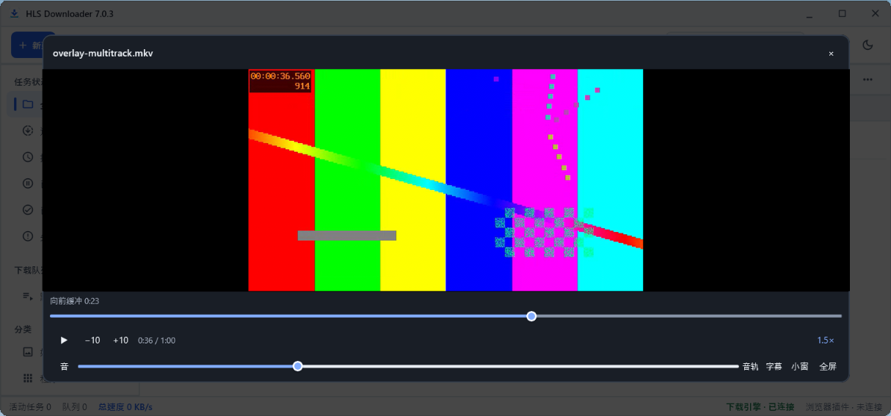
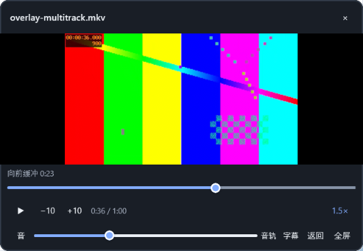
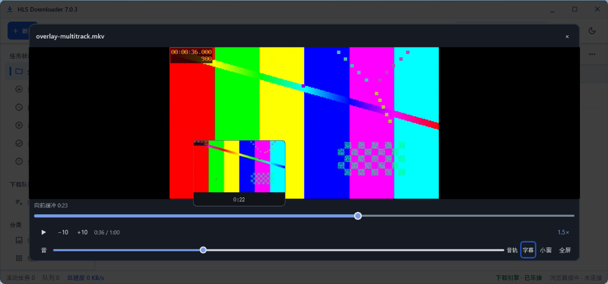

# v3 风格播放器验证（2026-10-17）

本轮为未提交工作区的本地验收包，没有签名、同步 GitHub 或在本机安装。完整记录及源码、组件、安装包哈希见 `validation-v3-player-20261017.json`。

## 实际通过

- 最终 Core release 三个可执行文件和 Compose UI 构建成功；最终 UI 现有测试 124 项通过，0 失败、错误或跳过。初始 Core 8 组共 203 项通过；后续 DPI/精确定位修复后重新编译，并在沙盒重跑播放器 2 项测试、原生播放器及 21 项下载播放回归，没有将 203 项冒充最终源码全部重跑。
- 主界面浮层真实按钮在 Windows 默认 125%、JVM 强制 100% 和 150% 缩放下各通过 9 组验收：播放/暂停、点击画面、前后 10 秒、拖动定位、音量/静音、倍速、双音轨/双字幕/关闭字幕、悬停缩略图、全屏/Escape、画中画拖动/返回、关闭/重开。每项核对真实 mpv 状态；返回后核对视频子窗口归属与像素，避免只验证控件存在。
- 修正实测发现的关键帧定位偏移、125% 原生视频缩小露白、缩略图被视频 HWND 遮挡，以及画中画旧宿主的延迟布局覆盖新宿主导致黑屏。缩略图实际截图与独立解码图片比对通过，不改变主视频暂停状态和位置。
- 最新 Core 的 21 项下载/播放/缓存检查通过：伪 JPEG 后缀 TS、fMP4、AES、独立音轨 HLS、DASH、HTTP；未完成时 80%→20%→80% 定位并实际解码、完成后原窗口切换成品、成品完整解码、默认清缓存、暂停保留续传、删除未完成任务清缓存并保留无关文件、关闭后完成不重开、主动保留临时文件及清理已完成。
- 最终 MSI 在沙盒安装到含空格的自选目录，默认下载路径匹配该系统 Windows Downloads Known Folder；真实 MDN flower.webm 下载字节与独立源请求一致，缓存自动清除；安装后主界面实际显示并连接 Core；卸载后产品注册消失。

## 体积

| 项目 | 旧包基准 | 最终包 | 增量 |
| --- | ---: | ---: | ---: |
| MSI | 302,559,232 B | 302,792,704 B | 233,472 B（228.0 KiB） |
| 安装文件合计 | 675,107,220 B（旧包行政解包） | 675,423,713 B（沙盒实装） | 316,493 B（309.1 KiB） |
| 安装文件数 | 265 | 265 | 0 |

没有新增播放引擎或第三方运行依赖。安装体积主要来自原有 FFmpeg（约 157.5 MiB）、ffprobe（约 157.3 MiB）、libmpv（约 114.2 MiB）、Java 模块和 UI 库，不会全部常驻内存。缩略图复用已有 FFmpeg，单并发、180ms 防抖、5 秒超时、128 KiB JPEG 上限、最多缓存 48 张 184×104 图片，不落盘。旧版实装历史报告比本次旧包行政解包基准少 50 B，表中没有混用这两种口径。

## 资源取样与边界

沙盒关闭虚拟 GPU，有 8 个逻辑 CPU。最终实装 UI＋Core 空闲取样 5.0 秒：整机 CPU 0.08%，工作集合计 220.8 MiB。下载并以 1.5 倍速播放的 Core＋播放器短样本为整机 CPU 51.04%、工作集合计 147.9 MiB。这次软件渲染播放 CPU 较高；不同运行时刻的旧样本不是受控基准，不能据此保证所有电脑或 4K 视频的性能。

安装目录选择通过 MSI 的 INSTALLDIR 实装验证，未实际点击图形向导的目录选择按钮。100%/150% 是 JVM 缩放覆盖，未验证多物理显示器切换或所有 Windows 版本。插件沿用源码哈希一致的既有未签名包及审核源码包，本轮没有重复浏览器、云字幕、投屏/TVBox 验收。

清理状态见机器可读记录的 `cleanup` 字段；不能将因策略拒绝保留的解包目录称作已清理。

## 界面实拍







## 收尾清理阻塞

最终未签名包已放到桌面 `HLSDownloader-7.0.3-v3-player-未签名.msi`，SHA256 与沙盒实装包一致。浏览器插件和 Firefox 审核源码包继续保留在桌面插件目录。只有 `main` 和一个 worktree，没有在本机安装，本轮沙盒已关闭。

自动审批先后拒绝了旧解包目录、旧桌面包替换命令，以及本轮构建缓存清理命令，只给出 `blocked by policy`，未提供具体原因。被拒绝的命令没有执行，未通过其他工具、改名或删除父目录绕过拒绝。因此仍有约 5.8 GiB 本轮缓存和一份旧桌面安装包，不能称作已清干净。

已准备长期保留于源码的 `scripts/finish-v3-player-cleanup.ps1`，通过静态语法检查，未由代理执行。它先校验桌面新旧安装包 SHA256，再只清理下列生成目录和哈希匹配的旧包，不操作用户下载、备份、注册表或其他项目；根目录为重解析点时会停止。支持 `-WhatIf` 预览。

- `.tool-cache/build-cache`
- `.tool-cache/player-v3-validation`（包含已明确列出的旧解包目录）
- `desktop_ui/.gradle`
- `desktop_ui/.kotlin`
- 桌面 `HLSDownloader-7.0.3-cache-playback-未签名.msi`

需要用户在 PowerShell 执行：

```powershell
& 'A:\Ubuntu\测试\hls-downloader\scripts\finish-v3-player-cleanup.ps1'
```
