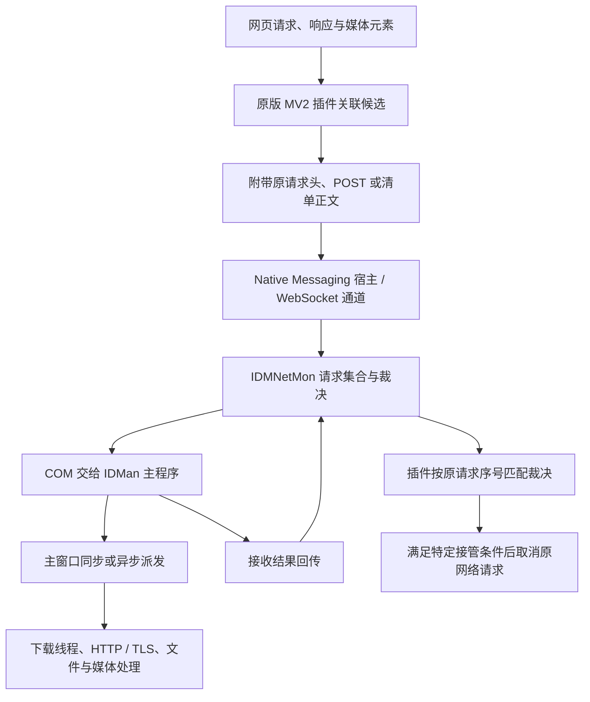

# IDM 参考源码、工作原理与重建完整性复核

日期：2026-11-08。交付项目为 `A:\Ubuntu\测试\hls-downloader`；`A:\Ubuntu\逆向` 仅作为只读输入。

下文的 119 模块、109 脚本及编译结果属于当时快照。2026-11-09 的增量复核见文末；最新恢复注释已更正动态切分函数地址，不再沿用旧地址冲突作为当前缺陷。

2026-11-14 的 Rust 实施与逐模块对应表见文末「逐模块实施」。历史快照中的“默认不启用动态切分”已过时；当前仅在具备资源校验器且未显式关闭时默认启用，不将历史结论当作现状。

## 结论与检查范围

本地材料已经提供了大量可以追到原函数的证据，尤其是浏览器请求关联、凭据传递、接管裁决、HTTP 工作线程及媒体对象的生命周期。但当前不能认定“原版全部成功反编译”“119 个 C 模块完整等价于原版核心”或“完整原生下载器与插件已通过真实浏览器验收”。

| 待核验说法 | 本轮独立结果 | 能成立的边界 |
| --- | --- | --- |
| 主程序 20,704 个函数的反编译代码全部到手 | 确有 20,704 份输出，索引与文件一一对应；其中 1 份只有超时占位 | Ghidra 已识别函数的导出集合齐全，不等于原程序所有函数均已识别、成功反编译或恢复成可编译工程 |
| 核心算法已完整恢复成 119 个可编译 C 模块 | 119 份确实存在；包含实际恢复函数，也包含证据常量、状态示意和探针。MSVC 对象编译 116 成功、3 失败，未完成整体链接 | 能支持继续分析和逐项恢复，不能直接当成完整、等价、可替换的下载引擎 |
| 桌面下载器和插件已经完整可用 | C# 桌面和宿主独立构建成功；实际 MV3 插件解码器的 4 个纯函数用例全部解析错误 | C# 自研应用可构建；没有证明原版等价、完整凭据接管或真实媒体重封装 |
| 剩余函数 40% 是微软库，其余主要是 UI | 40% 来自 324 个特定高频未提及函数子集，其中 129 个有库函数标记 | 不能扩大到主程序全部函数，也不能据此把剩余函数全部排除出核心调用链 |

本轮对四个完整导出目录的 **23,988 份文件做了清点、内容指标扫描和逐文件哈希**，对关键调用链做了静态复核，并非逐个函数完成语义还原或动态验收。没有运行原版 IDM、重建 EXE、参考安装/注册脚本或全部 109 个验证脚本。未修改 HLS 生产代码，没有借本轮调查宣称整个 HLS 项目已经完成。

参考快照为 `RECONSTRUCTION.md` 至 §186，926,592 字节，修改时间 2026-11-08 15:25；SHA-256 为 `fee5149c535ff228b5a927277b463da7f1a1274ba07805bc9d0236f80afe4323`。参考插件版本仍是 6.43.1，主体目标仍是 IDM 6.43 build 16。这是本地逆向材料的更新，不能当作厂商最新版本。

## 三类源码的关系

| 输入 | 实际性质 | 使用方式 |
| --- | --- | --- |
| `1_浏览器插件源码/idmmzcc3_6.43.1_deobfuscated/` | 原版解包、反混淆插件，MV2 | 追踪真正的事件、字段、请求关联与取消条件 |
| `2_项目主体源码/ghidra_decompiled/*_all/` | 原生二进制的 Ghidra 伪代码 | 配合反汇编、原始字节、调用方与对象偏移判断行为；不直接视作原厂源码 |
| `download_engine/`、`ipc_and_host/`、`media_parsers/`、`ts2mp4/`、`idman_main/` | 119 份人工恢复 C | 逐项核对来源、类型、所有权和依赖，不能因能生成对象文件就认定运行正确 |
| `2_项目主体源码/rebuilt_app/src/` | 六份 C# 源文件组成的独立重建应用 | 作为自研实现参考；不是上述 C 模块组成的原生程序 |
| `4_自研下载器/` | MV3 插件及重命名包装的 C# 引擎/宿主 | 必须测试实际插件代码与最终交付进程，不继承模拟协议客户端的通过结论 |

`rebuilt_app/build.ps1:17–38` 只编译 C#：宿主使用 `IDMMsgHostMain.cs`，桌面使用 `MsgWire.cs`、`MediaParsers.cs`、`DownloadEngine.cs`、`NetMonBus.cs`、`IDManMain.cs`。这里没有链接恢复 C。`4_自研下载器/README.md` 也说明 DlmEngine/DlmHost 包装的是这些 C# 产物。

## 原版目前能可靠追到的工作链

图中列出观察到的两种通信路径，不表示一次下载必须依次经过两种通道。主程序接收成功也不自动证明任务已持久落盘。

### 识别与嗅探

原版 `background.js:27,84–92` 注册请求、发头和收头事件，结合状态 200/206/304、MIME、Content-Disposition、文件名和站点规则关联候选。它不是只看 URL 后缀或页面里是否存在 `video` 标签。

原版 `document.js:1–9` 还覆盖 fetch、XHR、Response 读取等入口，用关联令牌衔接页面侧与后台，并通过克隆/分支获取响应正文。这使后台能够拿到无明显后缀、动态返回或由脚本读取的媒体清单。元素与几何信息服务于页面上的媒体定位；有候选不等于立即启动所有下载。

### 请求凭据与发起下载

原版 `background.js:89–90` 的序列化路径包含字段 11 的请求头、字段 14 的 POST 和字段 19 的正文，并处理 Referer、Cookie、User-Agent 等上下文。有效下载输入是一整次请求的上下文，不能缩成一个 URL。

宿主与网络模块使用 `IDMNetworkMonitor` 命名管道；网络模块还包含 `plugin.v3.internetdownloadmanager.com` WebSocket 子协议。网络模块通过 COM 将下载参数交给主程序，主程序再向主窗口派发。详细地址和同步/异步分支见 [原生交接追踪](idm-native-handoff.md)。本轮没有证明原版所有跨域跳转、凭据刷新或所有请求方法的完整规则。

### 回执、裁决与取消

原版 `background.js:63,67` 区分普通回执与原请求对应的接管裁决：不是收到任意 ACK 都取消浏览器请求。已确认的路径中，原请求 type 为 13 且裁决值为 3 才触发相应取消。

网络模块 `IDMNetMon_all/1001/0x10019010.c` 将 COM 调用的 HRESULT 映射为 3 或 1，再通过 `0xb1d7` 返回请求集合。主程序存在主窗口同步调用，也存在异步投递后先返回的路径。因此不能从这个回执单独推断“用户最终确认”“已经写入持久任务”或“用户取消后必定恢复浏览器”。

HLS 的合同继续是：持久接收并能呈现后由桌面负责；用户在桌面取消即结束本次下载；回执丢失按原业务 ID 查清状态。这个合同不能替换成普通传输 ACK，也不能声称它就是 IDM 原版的持久化合同。

### HTTP、分段和续传

原版 `idman_all/0059/0x00590000.c` 是复杂下载工作线程，涉及实际 I/O 和多分支控制；`005a/0x005ae310.c` 展示 64 位 Range 请求头以及不同 Accept-Encoding 分支。`0058/0x00582990.c` 实际解析 Content-Length/Content-Range，并推进响应状态。不能用一个固定顺序的状态图代替这些行为。

`0058/0x00580580.c` 能提供连接边界的 64 位计算线索，但当前材料中“找最大剩余活动段并对半切分”的归属仍有冲突，见后文。这里没有否定 IDM 的动态分段能力，而是尚未证明那份恢复算法对应哪个原函数、锁范围与调度条件。

TLS 方面，新增 `stream_sizes_named_recovered.c` 和 §161 已将 `+0x33A8`、`+0x33AC` 分别更正为 Trailer、MaxMessage。前轮指出的旧命名错误不能继续算作新文件尚未修正；旧恢复文件仍需结合这次更正阅读。

### HLS 与容器处理

材料中已有清单解析、分包、分帧、缓冲交接、音视频时间戳和 MP4 写出等原函数线索及部分恢复实现。不过这些组件的依赖、对象布局和实际可播放输出尚未整体闭环。发现清单、按序下载字节、解密、解复用、生成 MP4 是不同的环节，不能只验证最终字节相加就全部算完成。

### 媒体浮窗

原版不是仅靠页面 DOM 绘制下载条。`IDMNetMon_all/1003/0x10032500.c:40–59` 加载 `IDMBRBTN.DLL`，取出 `CreateIDMButton3`、`CreateDownlSelWtIDMButton`；`0x10031cf0.c:33–40` 调用创建函数并保存 HWND；`0x10031e90.c` 转换坐标，并在第 64 行发送 `0x40b` 同步矩形。

当前参考目录没有找到这个 DLL 或其完整反编译目录，因此只能追到浮窗创建与定位接口，不能声称原生绘制、输入和完整生命周期全部恢复。HLS 当前页面浮层可参考元素关联与坐标同步思路，不应因此引入未经验证的原生注入路径。

## 全量导出与统计的真实含义

| 导出目录 | 文件数 | 无反编译正文 | 含 WARNING | 含 unaff_/in_stack_ |
| --- | ---: | ---: | ---: | ---: |
| `idman_all` | 20,704 | 1 | 2,497 | 2,970 |
| `idmcchandler7_all` | 2,313 | 3 | 93 | 1,632 |
| `IDMNetMon_all` | 888 | 0 | 80 | 15 |
| `IDMMsgHost_all` | 83 | 0 | 25 | 10 |

WARNING 和未恢复栈变量不等于整份函数不可用，但意味着需要汇编和上下文校正。以下四份文件明确为超时占位：

- `idman_all/0048/0x0048fd10.c`
- `idmcchandler7_all/1000/0x100089f0.c`
- `idmcchandler7_all/1003/0x10031090.c`
- `idmcchandler7_all/1003/0x10035940.c`

`_toolchain/ghidra_scripts/ExportAllDecomp.java` 只遍历 Ghidra 已识别的非 external 函数，反编译失败仍写同名 `.c` 占位。文件数可以证明这份导出集的规模，不能证明反编译器没有遗漏其他入口或已准确恢复每个函数。

`tools/corpus_index.csv` 的 20,704 行与主程序输出相符。其保存的文档引用与模块提及并集为 387 个地址，本轮按当前文本扫描为 407 个。这只是地址提及统计，既不能换算成人工验证覆盖率，也不能证明核心剩余函数都不重要。

“40% 微软库”来自 `tools/crt_ratio.py` 所限定的 324 个高频、索引未提及函数，其中 129 个有 Ghidra 库标记。§184.9 本身也提醒“小不等于无关”“不能说主干完整”。不能把这组子集比例扩成全部 20,704 个函数的分类。

## 已确认的恢复或交付问题

### 恢复模块不等于完整引擎

119 个 C 文件分布为下载引擎 34、通信 5、媒体解析 23、TS/MP4 17、主程序 40。其中 87 个包含 probe 函数，83 个含未执行探针的声明。这是源码形态统计，不代表这些文件全无实际函数，也不代表探针曾运行。

具体例子：`request_header_builder_recovered.c:242` 之后主要是证据字符串、宏与 probe，并非完整请求头生成器；`resume_state_accessors_recovered.c:172`、`fmp4_fragment_parser_recovered.c:149`、`media_converter_driver_recovered.c:204` 的对应尾部也不能作为完整访问器、fMP4 解析器或媒体转换器调用。`http_worker_state_recovered.c:135,143` 是固定状态跳转示意，没有等价执行原下载线程的 socket/TLS/磁盘动作。

### 动态切分的原函数归属不成立（历史问题，现已更正）

`download_engine/IDMan_DownloadEngine_recovered.c:226,232` 将 `idm_split_largest_active_segment` 标为复现 `0x00582990`。但同地址完整伪代码明确是逐行解析 Content-Length/Content-Range，没有扫描最大段或对半分配。

恢复算法可以作为独立自研设计讨论，当前不能称为从该地址还原的 IDM 调度。补齐证据需要给出真正调度函数、调用方、锁与连接槽状态，而不是继续引用错误地址。

2026-11-09 复核：最新恢复文件已更正上述地址归属，具体范围与仍未等价的实现见下文「新增调度、解析器与链接测试复核」。本节保留早期发现，不作为当前文件仍有错误地址的结论。

### 音频恢复 C 重复更新同一字段（历史问题，现已修正）

`ts2mp4/ts_audio_stream_recovered.c:278–279` 连续两次执行 `self->committed += granted`。原程序 `0x00618bf0` 对应字节却分别更新两个字段：

| 指令地址 | 原始字节 | 行为 |
| --- | --- | --- |
| `0x00618c1e` | `01 86 9c 01 00 00` | `add [esi+0x19c], eax` |
| `0x00618c24` | `01 86 a0 01 00 00` | `add [esi+0x1a0], eax` |

本轮直接按 PE 节映射读取 `verify/targets/IDMan.orig.exe`，两组字节均匹配。原目标 SHA-256 为 `3b5dc9ce53eb31933effa3fd973bec068a78e0f8c1d15a919b081f0c4d9325ba`。这说明恢复代码存在编译器无法发现的语义错误；未修改参考输入。

2026-11-09 再次逐行核对最新恢复文件和 `ghidra_decompiled/idman_all/0061/0x00618bf0.c`：现在分别更新 `committed` 与 `committed_end`，上述重复更新问题已经修复；复制及累计使用原始长度也与该反编译函数一致。这只确认本段更正，不代表依赖的 reserve/drain 或完整 TS→MP4 链已经运行验收。当前文件身份见 `artifacts/component-sync-20261109/reference-check.json`。

### 自研 MV3 插件解码器（历史问题与当前部分修复）

`4_自研下载器/extension/background.js:63–84` 的 `decodeMsg` 对 `MSG#seq#code#flagsA#flagsM:extras` 使用 `split(":")`，字段区再直接按逗号拆，破坏长度限定字符串。

本轮提取实际函数，仅去除 `export` 后用现有 Node 的 vm 执行，没有重新写一个替代解码器：

| 实际输入 | 应得结果 | 实际错误 |
| --- | --- | --- |
| `MSG#7#1#0#0;` | seq=7、code=1 | seq=0、code=0 |
| `MSG#0#4#0#0:1058,1=3:ZIP;` | code=4 | code=1058 |
| `MSG#0#12#0#0:7:1:42;` | code=12，保留裁决参数 | code=7，extras 为空 |
| 长度限定字段值 `ZIP,A` | 完整保留 `ZIP,A` | 截成 `ZIP` |

该目录 README 虽称分隔符问题“已修”，当前交付 JS 仍有上述错误。`test/verify_chain.py:58–90` 使用自身正确的 Python 解析器，未验证这段实际 JS，因此其通过不能覆盖此缺陷。

此外，该插件 `background.js:235–242` 会让同序号的任意消息兑现等待，而 C# `NetMonBus.cs:627–631` 先发普通 Code 1 ACK，之后才有 Code 12 裁决和入队路径。`onVerdict:313–329` 又依赖没有绑定的 `downloadId`。即使修了解码，也需继续验证真正的下载取消与责任转移，不能认为通信有帧就等于完整接管。

2026-11-09 最新文件核查更正：上述表格是旧版本复现。当前代码已按 `#` 解析消息头；直接提取实际 codec 执行后，ACK、配置消息和裁决参数三项都正确。`onHostMessage` 已明确忽略 Code 1 的请求兑现，候选下载路径在等待裁决后使用闭包中的 `item.id` 取消浏览器下载，不能继续称这两处仍未修复。长度字段仍按逗号拆分，实际执行 `ZIP,A` 得到 `ZIP`，UTF-8 的 `下载,MP4` 编解码往返得到 `下载`，两项仍失败。完整记录与当前源码哈希见 `artifacts/component-sync-20261109/reference-codec.json`。没有运行参考浏览器或桌面程序，也未修改它们；HLS 继续保留自身的结构化消息、持久接收与凭据作用域合同。

### 自研 C# 引擎会削弱 HLS 现有能力

`DownloadEngine.cs` 确有协调器、锁下找最大剩余活动段并对半切分、worker 动态检查尾界、分段状态保存及按起点拼接；这些是可以阅读的自研实现。

但实际调用链存在以下不足：

- `RawRequestHeaders` 只在请求规格声明，创建任务时不保留；请求构造只使用 Cookie/Referer/User-Agent，没有把完整 Authorization、Origin 和 POST 上下文贯通。
- `LoadTaskState` / `SaveTaskState` 不保存这些凭据；恢复下载不重新探测身份。worker 收到 206 就续写，没有验证本次 Content-Range 起点、总长和 ETag。
- 暂停任务按忽略大小写的 URL 匹配并复用，未刷新请求凭据，可能错误合并不同身份或路径的请求。
- 状态和结果使用先删旧文件再 Move；暂停线程只 Join 3 秒，而请求读取超时可达 15 秒，没有主动终止全部阻塞请求。

这套实现不能整体覆盖 HLS 现有凭据、身份校验、取消和原子输出逻辑。

### HLS 字节串接没有证明 TS 转 MP4

`DownloadEngine.cs:970` 的 `RunHlsDownload` 解析清单、选变体、逐段读取、处理 AES-128，然后将字节顺序写到临时文件并移动，清单文件名改为 `.ts`。它没有接入那 119 份 C 的 TS 解复用和 MP4 写出，也没有调用 FFmpeg。

`verify_rebuilt_e2e.py:103–105` 的 HLS 夹具使用随机字节，检查的是串接哈希，不是合法 TS/fMP4 的轨道、时间戳、封装结构或可播放性。相关端到端脚本面向 C# 重建程序，使用模拟协议客户端/stdio，不能代替实际浏览器插件验证。

## 本轮实际验证

| 检查 | 结果 | 限制 |
| --- | --- | --- |
| 四套 Ghidra 输出清点、指标扫描、逐文件哈希 | 23,988 文件；主程序索引完全对应 | 非逐函数语义验收 |
| 119 C 模块和 109 验证脚本清点 | 已记录文件及哈希 | 未批量执行参考验证脚本 |
| 原有 Zig 的独立对象编译尝试 | 编译器在 C 分析前因缓存目录 AccessDenied 退出 | 本轮未复现 Zig 的 119/119；这不是 119 份 C 都有编译错误 |
| 现成 MSVC x86，`/c /W3 /utf-8 /std:c11` | 116/119 生成对象，3 失败，17 条警告 | 与 Zig 的扩展兼容不同；没有做完整链接或运行 |
| 116 份 COFF 对象的项目符号联合检查 | 仍有 73 个未提供定义的自定义符号 | 仅限成功对象集合，不等于已运行链接器判定整个工程 |
| 全部 119 C 源码 extern 扫描 | 78 个未找到源定义的外部函数名 | 正则检查不展开宏，不是链接证明；与 COFF 统计口径不同 |
| C# 桌面和宿主独立构建 | 两者成功，70,656 / 10,240 字节 | 未启动、未注册，不链接恢复 C；不能以此体积比较原生完整产品 |
| 自研 MV3 实际 `decodeMsg` | 4/4 用例失败 | 只执行纯函数，未运行浏览器 |
| 音频恢复字段与原程序字节 | 两处字节确认更新不同偏移 | 静态比对，未执行参考程序 |

MSVC 的三个失败点是 `m3u_parser_recovered.c:170` 零长 padding、`pipe_frame_recovered.c:117` 数组长度为负、`ts_video_stream_recovered.c:150` 零长 padding。不能用 MSVC 扩展差异反推原 Zig 编译报告造假；同样，单文件 `-c` 成功也不能证明完整链接和算法正确。

未执行 HLS Rust/扩展回归，因为本轮只新增分析记录，没有改变其运行代码；此前实际验证见 [浏览器参考与功能补齐](browser-reference-completion.md)。没有进行同环境的 IDM/HLS 包体积、内存、CPU、吞吐或断线恢复对照，不能声称已达到同等性能或稳定性。

## HLS 的采用边界

| 机制 | HLS 当前实现与本轮决定 |
| --- | --- |
| 请求、响应、正文和元素联合发现媒体 | 继续使用现有网络/页面嗅探，保留 200/206/304；原版关联方法有参考价值 |
| 真实请求凭据进入桌面 | 保留精确请求上下文；不退回重建应用的三种头部模型 |
| 回执后取消原下载 | 保留持久接收、可呈现与原 ID 查询，区分 ACK、接收和用户取消 |
| 动态分段 | `native_shell/src/http_engine.rs` 已有安全边界切分；只在 `HLS_HTTP_ACTIVE_SPLIT=1` 且有 Range validator 时启用，默认不启用。不能把恢复代码的错误地址当作开启依据 |
| 续传身份与输出完整性 | 保留现有 Range/If-Range、ETag/Content-Range 和原子输出，不整体替换成 C# 重建引擎 |
| 媒体后处理 | 保留 FFmpeg 合流、同目录暂存及成功后原子替换；当前恢复 C 不足以支撑替换为自制完整封装器 |
| 浮窗 | 可参考媒体元素关联和几何同步；缺少原版绘制 DLL，不能宣称完整复现 |

本轮没有发现需要为了模仿而立即替换 HLS 架构的可靠依据。新增材料最直接的价值是提供原函数入口和可检验的不变量；采用时仍应解决 HLS 中具体复现的问题，并保护已有功能。

要进一步认定“核心恢复完成”，尚缺：动态调度的正确原函数与锁/边界证据；119 模块统一接口、布局及外部符号提供者和完整链接；合法音视频的实际封装验证；最终 MV3 插件的鉴权下载、ACK/裁决、取消与重连实测；`IDMBRBTN.DLL` 的绘制/输入链；同版本同条件下的资源和性能对照。这些是当前结论的证据缺口，不是要求 HLS 重写所有原版 UI 和库函数。

## 本轮证据

工作区目录：`artifacts/idm-full-audit-20261108/`。参考文件保持只读，没有复制原版伪代码进 HLS 生产代码。

- `inventory.json`、`decompiled-files.csv`、`modules.json`：快照、全量文件指标/哈希和恢复模块清单。
- `high-frequency-scope.json`：40% 比例的真实分母。
- `source-sha256.json`、`verifier-source-sha256.json`：关键输入与验证脚本身份。
- `dsh-extension-decoder-repro.json`：实际 JS 函数的输入、期望、输出及源码哈希。
- `audio-stream-mismatch.json`：原目标身份、两组原始机器码和恢复字段冲突。
- `compile_modules.py`、`msvc-compile.json` / `.log`：本轮独立编译命令、结果和 COFF 符号统计；脚本保留于证据目录，未设为 HLS 构建步骤。
- `c-compile.json` / `.log`、`c-cache-probe.log`：Zig 在 C 分析前发生的环境错误。
- `source-dependencies.json`：源级 extern 依赖清点。
- `csharp-build.json`、`csharp-build.log`：两个构建结果、输出哈希及首次路径参数失败记录；修正为 Windows 本机路径后的构建成功。
- `audit-summary.json`：实际完成、未执行范围与清理状态。
- `cleanup.json`、`cleanup-preflight.json`：临时产物留存位置、归属与边界检查，以及自动审批拒绝记录。

对象文件和临时 EXE 是一次性验证产物，不属于项目发布包。首次删除被自动审批拒绝；后续用户明确要求清理后，重新确认归属、进程、文件哈希和目录边界，再次使用 PowerShell 原生删除，仍被自动审批以 `blocked by policy` 拒绝，没有实际执行删除或改用其他工具绕过。故 `.tool-cache/idm-full-audit-20261108/`（117 个对象文件、两个 EXE，共 393563 字节）及 `.tool-cache/build-cache/zig-idm-reference-audit/`（空缓存目录）仍保留，需要用户手动删除这两个确切目录才能完成残留清理。审计证据在 `artifacts/`，未受影响，不应扩大到其他缓存或历史现场。

后续根据这些证据落实到 HLS 的辅助请求身份和 frame 隔离修复，见 [浏览器参考实施记录](browser-reference-completion.md#辅助媒体请求身份与-frame-隔离2026-11-08)。该项实施与本次只读审计分别记录验证结果。

## 新增调度、解析器与链接测试复核（2026-11-09）

本次静态读取最新 `CMakeLists.txt`、恢复 C、新增验证脚本及对应 Ghidra/radare2 输出。参考顶层 README 当前宣称 123 模块、114 脚本；这不是本项目独立执行后的通过结果。没有运行参考程序、编译或验证脚本，也未修改参考目录。

| 核对项 | 实际源码证据 | 对 HLS 的结论 |
| --- | --- | --- |
| 分段函数地址 | `IDMan_DownloadEngine_recovered.c` 已更正 `0x00582990` 为 Content-Range 解析；`chunks_list_recovered.c` 补出 `0x00560610`、`0x00559D00` 等入口 | 旧地址归属问题已更正；仍需分别核实新恢复函数的行为和布局 |
| 范围选择 | 原 `0x00559B90` 日志为 `FindChunkWithZipCentralDir`，`0x00560610` 有独立调用；恢复 C 的 `use_alt_finder` 分支却仍调用普通最大块选择函数 | 借鉴按使用目的选择区间；HLS 已有 ZIP 尾部范围预览和播放 seek 优先，不重复引入同类机制 |
| 开连接门槛 | 原 `0x0055B060` 从对象 `+0xC0` 的 64 位量计算 `2 * value + 3`；恢复 C 改用传入参数的两倍或固定常量 | 不能将恢复门槛视为原版完全相同，更不能照搬常量证明 HLS 动态切分已验收 |
| 块布局和实际 I/O | 恢复 `IdmChunkItem` 将 64 位 `endPos` 标在 `+0x10`，又将后续 `isCompleted` 标在 `+0x14`，这两项偏移标注互相矛盾，声明布局无法满足；文件打开函数是模拟成功，注册表分支只记日志，`join_file` 只统计长度而未写目标 | 新恢复模块仍不能替代 HLS 的真实文件、续传和原子输出实现 |
| 连接完成后的交接 | 原 `0x00584860` 检查相邻区间和连接状态并更新记账；恢复函数只找最大块并返回其 ID | 有进一步核查连接交接的价值，不能把两者称为等价实现 |
| 站点解析 | 原 `0x10041480` 按引号提取并处理部分转义；恢复 `extract_json_string_val` 遇 `&` 即停止，会截断签名 URL。原 `0x10042E80` 调用时长解析器，恢复版本将该处时长设为 100 | 不移植会损坏 URL、凭据关联或媒体时长的简化解析器 |
| 新增原生链接脚本 | `verify_native_link.py` 将对象归档后，测试程序只引用 4 个 probe，检查退出码和输出标记 | 能证明被引用路径可链接运行；没有覆盖整套算法、外部依赖和真实下载流程 |
| 新增 TS 测试 | `verify_ts_remux_real.py` 生成 4 个 TS 包，测试程序调用 CRC 并自行检查 PID/PES 标记；没有调用完整解复用/封装链或写出 MP4 | TS 包检查不能替代合法音视频的 MP4 成品、时间戳和播放验证 |

此外，`0x00560610` 的 Ghidra 输出在调用 `0x0064A48D` 处带有“不返回”警告而截短后续控制流；`0x0064A48D` 自身输出却是返回的 `_free`，radare2 输出还保留后续分段和注册表写入指令。分析不能仅凭该份 Ghidra 结果缺少尾部就认定原程序没有这些行为。

HLS 本轮采用的是具体的资源生命周期优化：首次领取范围后才打开 payload 和分配 1 MiB 写缓冲，已初始化的 worker 继续复用缓冲；不更换调度算法，不启用实验尾段切分。实际失败复现和回归结果另记于 [原生化实施记录](native-migration-progress.md)，不能据此宣称已测得内存峰值或速度优于 IDM。

## HTTP 读取阶段与协调停止复核（2026-11-09）

- 本轮只读对照 `http_worker_state_recovered.c`、`http_status_dispatcher_recovered.c`、`chunks_list_recovered.c` 及原 `ghidra_decompiled/idman_all/0059/0x00590000.c`。前三个恢复模块相对上次清单未变；输入哈希见 `artifacts/idm-native-refinement-20261109/reference.json`。没有运行参考程序、脚本或构建。
- 原 worker 在 `Stop HTTPC 7495` 路径调用 `0x00584860` 后检查连接状态，case 7 还调用协调器 `0x00560610`。这些路径支持继续核查读取、停止与区间交接的联系，但不能据此认定 HLS 的共享原子停止标记与 IDM 逐行等价。
- 恢复代码将状态 38（`0x26`）命名为 `SEGMENT_FLUSH`，原反编译的该分支却包含 SSPI/TLS 处理和 `0x005f6d60` 调用；现有证据不足以将其直接认定为落盘阶段。恢复模块的简化状态跳转不能替代真实传输状态机。
- HLS 自身调用路径暴露的问题是：范围请求开始前检查共享停止，正在读取 206 正文和等待限速时却没有检查。该问题应在 HLS 现有调度和检查点机制内修复，并验证首次错误、暂停、取消及续传语义；不需要更换 UI、协议或重复引入下载架构。实施和实测结果见 [原生化实施记录](native-migration-progress.md)。

## 逐模块实施（2026-11-14）

基线为 `7636ad417afec41cce81cf078af0a40598db1fff` 加工作区已有 Firefox 修复；这些修改保持原样并继续进入回归。参考输入身份见 `artifacts/idm-port-20261114/reference.json`。参考目录只读，不执行 IDM，不链接恢复 C 或私有 DLL，不引入第二套引擎。

下表状态针对已列出的行为，不能扩展为整个 IDM 模块逐字节等价。“已适配”表示进入现有 Rust/MV3 生产路径；“有意不同”表示保留 HLS 的明确合同；运行时、性能与原版对照分别列出，不由静态相似推断。

| IDM 原函数及调用方 | 已确认行为 | HLS 实际路径 | 差异与修改 | 状态及验收依据 |
| --- | --- | --- | --- | --- |
| 插件 `Ka/Cb/Fb → nc/Y → X`；原生 `0x0042cf20 → 0x0042a180` | 请求、响应头、请求正文与 tab/frame 请求序号一起进入候选；裁决后决定取消；桌面异步投递可先返回成功 | `background.ts` 的 `prepareFirefoxFileRequest`、响应候选、`offerDownload` 与恢复查询；`clickIntentStore` | 补齐同源 `download` 属性的无后缀链接、指定文件名和会话恢复；保留精确 URL、方法、正文及凭据。Chromium MV3 无全局阻塞 webRequest 能力，不能强行声称所有请求都可发送前截获 | 已适配；`downloadOwnership.test.ts` 注册事件回归覆盖新点击、普通导航、存储失败和丢回执恢复；完整插件测试另见本轮报告 |
| 同上裁决链；网络模块 `0x10021300` | ACK 与下载裁决不同；主程序接收和用户操作不是同一时刻 | NativeBridge、Core 持久 handoff、`desktopAcceptedHandoff` | HLS 要求持久接收且可呈现后才转移责任；按原 ID 查结果，用户取消终止本次下载。这比已确认的 IDM 异步成功返回有更强的持久约束，继续保留 | 有意不同；所有权、重启恢复与凭据回归，不把 ACK 当持久接收 |
| 插件响应分类及页面元素关联 | MIME、附件响应头、请求与页面共同决定媒体候选，不能仅依赖后缀 | `manifestSniff` → MAIN-world 有界前缀观察 → 后台资源 → Core HLS/DASH | 修复 `#EXTM3UX` 误识别和 XML 注释后 DASH 漏识别；不扫描 HTML 内的伪标记，不新增全页面响应复制 | 已适配；扩展伪头、错误页、截断注释、命名空间及普通页面流量回归 |
| `0x00560610 → 0x00559d00`；HTTP worker `0x00590000 → 0x0055b060/0x00560610` | 普通模式选择扣除已接收、缓冲和预留后的剩余区间；开连接受剩余量门槛控制；ZIP 有单独 finder | `RangeScheduler::claim`、`ActiveProgress`、`AdaptiveConnectionController` | 已有最大安全尾部切分，响应身份校验后才允许切；保留播放 seek 优先和资源身份门槛。HLS 最小切分 256 KiB、初始最多 2 连接及拥堵退避，不照搬原对象 `+0xC0` 的 `2*x+3` 或旧机器常量 | 已适配；`active_split_*`、`adaptive_scheduler_*`、播放区间覆盖回归。当前默认按校验器开启，显式 0/false/off 关闭 |
| `0x00590000 → 0x00584860` | 完成时同时调整连接状态、块记账及后续调度；存在相邻连接交接 | `range_worker` → `fetch_range` → `persist_range_progress` → `RangeScheduler::complete` | 调整终态顺序：先保存失败/整包转交流程的停止状态，再释放活动范围和通知。继续使用 Rust 所有权管理 worker，不移植原对象内存布局或停止其他线程的私有调用 | 已适配；范围忽略、唯一整包响应保全、共享停止、暂停、取消、并发检查点回归 |
| `0x00584e80 → 0x00582990` | 读取 Content-Length、Content-Range 起点、终点和总长；调用方比较字段，存在站点及模式分支 | `fetch_range` 的真实 HTTP 206 路径 | 复现 HLS 可把 `bytes 0-3/10` 加 10 字节正文判成功；新增终点/Content-Length 一致性检查和按响应终点限制读取。合法短区间继续从下一字节请求，错误元数据不进入检查点。不能把原调用方特殊分支推广成 IDM 所有响应都作相同验证 | 已适配；新增本地 TCP 反例、短区间、空响应有界重试、身份变化及最终字节一致性回归 |
| `0x00578290 → 0x00573e20`；`0x00577f50 → 0x00573fa0/0x00574f60` | 非零偏移发 REST；检查 REST 回复；PASV 解析数据端点；不以收到控制回复代表数据完成。原版 REST 分支检查回复首字符为 `3`，不是精确 `350` | `ftp_engine::download_ftp` → SIZE/MDTM → EPSV/PASV → REST → RETR | 保留 SIZE+MDTM 资源版本续传、精确 350 回复、PASV 仅采端口而使用控制连接 peer；失败不续写旧资源。2026-11-15 才真正补入 EPSV 优先及 IPv6；旧版对应表提前写成已支持属记录错误。仅 IPv4 的 500/501/502/504 可回退 PASV，畸形成功、临时错误或权限错误直接失败；严格解析六个八位字段，REST 紧邻 RETR | 已适配（被动单流合同）；EPSV 成功/拒绝/畸形、PASV 回退/坏字段、IPv6、已有文件保全、身份续传和停止回归。EPSV 依据 RFC 2428，未从已读原函数确认原版有该分支；FTP 多连接/主动 PORT 尚未完成 |
| `0x1003f5b0 → 0x1003ede0` | 逐行消费 HLS、按 tag 分派并携带段、密钥及初始化信息 | `hls::parse_playlist` → 分片下载 → 现有 FFmpeg 封装 | 首个实际行必须是完整 `#EXTM3U`，继续容忍 BOM/前导空白；隐式 BYTERANGE 只能延续相邻同资源，LL-HLS part 与完整段分别记偏移，避免跨资源或跨类型复用旧偏移。保留 LL-HLS、字幕、广告跳过和播放优先 | 已适配；伪清单、byte range、轮换密钥、init map、gap、直播等回归；首行和相邻偏移约束同时依据 RFC 8216，未声称是原版逐字相同策略 |
| 原媒体解析链；`0x1002c598 → 0x1003fb70 → 0x1003fa40` | fMP4 box 长度有界读取，提取轨道与时长；该函数是 MP4 读取器，不能误当 XML MPD 解析器 | `dash::parse_mpd` → 时间轴/轨道下载 → `mux_av` | 使用项目已有 roxmltree，保留签名 URL、继承、时间轴与分片上限。2026-11-15 补入 SegmentList 的 Initialization.range/SegmentURL.mediaRange：同 URL 不同范围分别下载、去重和记账；请求使用现有凭据与传输，严格校验 206/Content-Range/长度后以 64 KiB 缓冲落盘。替换前先持久失效旧检查点，防止失败文件冒用旧身份；旧整段身份格式不变。SegmentBase/sidx 的后续实现单列如下；仍拒绝多 Period | 已适配（当前支持的 DASH）；范围解析、视频/音轨/字幕下载、范围变化后重新下载、直播范围和时长累计、错误响应及写满后失败重启回归。真实 2 秒 fMP4 经范围下载及封装，20 帧解码哈希一致；不据此宣称所有媒体或与 IDM 等效 |
| `0x0055a250 → 0x005d0250 → 0x005d0180 → 0x005cfef0 → 0x005cfd80` | 调用方加载索引文件，用引用数参与区间规划；扫描 32/64 位 box，将 box 结束绝对位置加至 first_offset；引用表每项 12 字节，保存 31 位媒体长度；拒绝 reference_type=1 的嵌套索引 | `parse_mpd` → 选定视频/音轨 → `expand_segment_base` → `parse_sidx` → 既有范围下载、检查点、预览和封装 | 读取 SegmentBase.indexRange，按已选轨道展开 URL、字节范围与时长；保留签名 URL 和凭据。SIDX v0/v1、32/64 位 box，偏移加法检查溢出。原版 3,000,000 字节是读取缓冲上限；HLS 将整个请求索引限制在此大小，属于明确适配。HLS 额外要求 timescale/长度/时长非零、flags 为零、引用表长度精确；不支持 size=0、外置 RepresentationIndex 或嵌套索引 | 已适配（所列 SegmentBase 变体）；具体回归与真实双轨成品结果见 [本轮记录](idm-port-validation.md)。该调用链不能证明 MPD XML 解析器与原版相同，也不证明全部 DASH 变体或性能达到 IDM |
| 原 TS/MP4 转换与音频状态；恢复模块中部分 descriptor 仍标未实测 | 原版有完整解复用和封装调用链；恢复 C 单个 CRC/probe 不等于成品 MP4 | `media::merge`、FFmpeg `-c copy`、同目录暂存和原子替换 | 保留现有完整封装路径，不替换成模拟 I/O 或随机字节串接；失败、暂停不发布残缺成品 | 有意不同；真实合法媒体验证需解码、轨道、时长和帧哈希；CRC/probe 不能作为替代 |
| 插件 `Wb/Ub/Zb/rb` 及媒体元素生命周期 | 元素/frame 关联、可见性及几何变化决定浮窗生命周期 | `mediaOverlay`、`content.ts` 的 Resize/Intersection/MutationObserver 与 shadow root 注册 | 现有 DOM 浮窗保留；只观察已注册根和媒体相关属性，隐藏或移除后清理。原生 IDMBRBTN 绘制 DLL 未接入，UI 不改为 IDM 外观 | 已适配（关联和生命周期）／有意不同（绘制）；现有几何、遮挡、shadow、销毁测试；未做本轮个人浏览器运行验证 |
| 连接、缓冲及媒体子进程生命周期 | 按需分配、结束后释放；不能从恢复程序体积推断完整引擎占用 | 领取首个范围后才打开文件和分配 writer；已有流式网络与按需 FFmpeg | 保留已有惰性 writer 和复用缓冲；本轮 DASH 删除重复字符串扫描。没有为了“看似原生”重复引入恢复 C 或第二套 runtime | 已适配；现有资源生命周期回归通过。五轮中位数采集脚本已补齐，但本轮尚未运行；没有同条件原版 IDM 性能证据 |

### 保留的功能与未闭环项目

SFTP、BT、字幕、播放、投屏、TVBox、队列、计划任务和站点同步继续通过现有 Core；本轮没有重新建立平行服务，也没有改 UI 或迁移数据库。

已知对标差异包括 FTP 多连接/主动模式、DASH 多 Period 和未支持的索引变体、自制完整封装器和 IDM 原生浏览器浮窗。前两项尚未全部完成；后两项按本轮约定保留现有实现。SegmentList 显式字节范围及带 indexRange 的非嵌套 SegmentBase/sidx 已于 2026-11-15 接入实际下载路径。未读取清楚的原版调用链不标“已等效”。原版同条件吞吐、CPU、内存与异常恢复比较仍未执行，不能写“达到 IDM”。本地回归和构建不替代独立桌面/浏览器、安装升级或 Mozilla 签名验收。

首行与相邻 byte range 的规范依据：[RFC 8216 §4.3.1.1、§4.3.2.2](https://www.rfc-editor.org/rfc/rfc8216.html)。

EPSV 及控制连接 peer 的规范依据：[RFC 2428 §3–4](https://www.rfc-editor.org/rfc/rfc2428.html)。SegmentList 属性核对使用 [ISO MPEG-DASH MPD schema](https://standards.iso.org/ittf/PubliclyAvailableStandards/MPEG-DASH_schema_files/DASH-MPD.xsd) 中的 URLType.range 和 SegmentURLType.mediaRange；这些规范补齐不冒充已确认的 IDM 原函数逐字移植。

SIDX 的 32/64 位 first_offset、box 结束位置和时长计算另核对官方 [Shaka MP4 索引解析器](https://github.com/shaka-project/shaka-player/blob/main/lib/dash/mp4_segment_index_parser.js) 与 [dash.js SegmentBaseLoader](https://github.com/Dash-Industry-Forum/dash.js/blob/development/src/dash/SegmentBaseLoader.js)，没有复制其实现。原版 `0x005cfed0` 是析构 wrapper，不能作为 SIDX 解析入口；实际入口和调用方已列于表中。原版允许按原文件 EOF 解释 size=0，HLS 对有界 indexRange 明确拒绝此变体。输入身份保存在 `artifacts/idm-sidx-20261115/reference.json`。

### 上一批源码回归与交付证据（2026-11-15）

以下为浏览器/HTTP/HLS/XML 改造的验证快照。随后补齐的 FTP EPSV 与 DASH SegmentList 字节范围，以 [后续验证记录](idm-port-validation.md#2026-11-15-ftp--dash-后续验证) 为准；不能把历史整包产物或旧测试数当作最新交付结果。

完整回归额外发现成品路径与缓存清理之间的竞态：`published.path` 在两次查询之间被清理时，已完成任务可能显示临时 payload 路径。本轮改为一次读取 marker；读取失败时采用完成快照已持久化的合法成品路径，原成品丢失也不改指向其他任务的同名文件。确定性回归覆盖不可读 marker、删除 marker 以及原名称被其他文件占用。删除已无生产调用的包装函数，所有测试直接验证实际解析路径。

| 实际执行 | 结果 | 证据及边界 |
| --- | --- | --- |
| `cargo test -p hls-native-shell -p hls-client -p hls-protocol --lib` | 723 通过，14 忽略，0 失败 | `rust-regression-final.log`；Core 664、client 48、protocol 11。忽略项包含 UAC、Sandbox 传输与真实 FFmpeg 场景，不能当作通过 |
| 删除旧包装函数后的 `cargo test --locked -p hls-native-shell --lib download_worker::tests` | 103 通过，1 忽略，0 失败 | `publication-final-regression.log`；为上述全套的子集，不重复累计测试数 |
| 扩展 `pnpm test` | WXT 类型生成、TypeScript 类型检查、54 文件 606 测试通过 | 浏览器事件与 Native Messaging 使用模拟环境，未操作个人浏览器 |
| `pnpm run package:store` | Chromium、Firefox 及 Firefox 源码 ZIP 生成成功 | `extension-packaging.log`；Firefox 包尚未签名，不是永久安装包 |
| `cargo build --locked --release -p hls-native-shell --bin hls-downloader-engine` | 最终构建成功，无编译警告 | `core-release-final-build.log`；生成当前工作区 Core，未重建或验收整套安装包 |
| 最终 Core `--self-test` | 退出码 0，输出 `HLSDownloaderEngine 7.0.6 self-test ok` | `core-self-test.json`；仅建立内存 Core，不创建托盘、注册项或生产 IPC，不代表真实下载成品验收 |
| 四份修改的 Python 验收脚本 | AST/语法编译通过 | `python-syntax.json`；没有执行产品运行流程 |
| 当前代码与输入身份 | 333 份项目代码/配置哈希、21 份参考输入哈希已记录 | `source-files.json`、`reference.json`；Firefox 源码包内 74 份对应文件哈希与工作区一致 |

DASH XML 改造后的首次全套回归曾发现时间轴边界错误，原因是 roxmltree 的 `next_siblings()` 包含当前节点；两个实际调用处已跳过当前节点。修改后 DASH 定向及上述完整回归均通过，首次失败日志保存在 `rust-regression.log`。HTTP 矛盾 206、清单伪头与成品路径竞态均先实际复现，再修复。

最终 Core 构建、自检、产物哈希和未执行范围见 [源码验证记录](idm-port-validation.md)。原始日志和开发构建保留在本地忽略目录 `artifacts/idm-port-20261114/`；源码仓库不混入安装包、缓存或私有凭据。产物为未发布开发构建，没有将旧安装包验收改记为本轮通过。

本轮临时资源未完全清除：旧 Core 提取副本约 15 MB，以及测试临时目录内两份共 28 字节的夹具仍保留。两次 PowerShell 清理均在执行前被自动审批以 `blocked by policy` 拒绝，没有更换工具或删除方式绕过；确切路径与预检记录见 `cleanup.json`、`cleanup-preflight.json`、`cleanup-temp-preflight.json`。没有本轮常驻 Core 或编译进程继续运行。

随后按用户 2026-11-15 的源码整理要求，已删除 Rust target、Compose 与扩展可重建输出；上述小量残留再次被策略拒绝，仍明确保留。最新同步、Clippy 修正和整理范围见 [源码验证记录](idm-port-validation.md)，GitHub 已有 Release 不变。
